# Estudo Completo: Reformulação de UI Mobile, Inimigos Dark Fantasy Perturbadores e Estética de Mundo Morrendo

| Campo | Valor |
| --- | --- |
| Status | Proposto — aguardando avaliação e decisões do Orlando |
| Escrito em | 2026-11-19 |
| Tarefa ligada | `TASK-051` (`docs/tasks/TASK-051-estudo-ui-mobile-inimigos-estetica.md`) |
| Origem | Pedido do Orlando: reformular UI mobile (menus engessados, pouco espaço para o inimigo), estudar RPGs/roguelikes/táticos mobile, projetar inimigos perturbadores estilo FFT/Square Enix (Nano Banana + spec IA-friendly para Blender) e refinar estética dark fantasy de mundo morrendo |
| GDD | Seções 3, 6, 7, 11, 13, 17, 18, 19 |
| ADRs ligados | `ADR-0036`, `ADR-0037`, `ADR-0038`, `ADR-0039`, `ADR-0040` |

> **Documento de avaliação (sem alteração de código de gameplay).** Todas as referências visuais baixadas de lojas públicas estão em `docs/design/refs/` apenas como material comparativo de estudo (invisível ao Godot via `docs/.gdignore`, nunca usadas como assets do jogo, conforme GDD §18).

---

## Sumário Executivo

1. **O combate atual entrega apenas ~17% a 19% da altura da tela para o inimigo e o cenário 3D.** Embora `Combat3DStage` receba ~330 px em 540×960, as faixas internas opacas/semitransparentes no topo (`_intent_panel`) e na base (`_forecast` + `_log_label`) comem cerca de 145–160 px por dentro, deixando um corredor de **~160–185 px** onde inimigos e cenário competem por atenção enquanto **11 a 12 botões cinzas quase idênticos** dominam os 450 px inferiores.
2. **Os menus e painéis atuais violam ergonomia mobile.** Em `RunPanelScreen`, Loja, Fogueira, Evento e Recompensa usam uma única caixa preta rígida (`anchor_top = 0.50..0.98`) empilhando botões em CAIXA ALTA com paredes de texto; o preview de dano no combate usa `mouse_entered` (que não existe em toque mobile); HP/MP aparecem duplicados em texto + barra; e telas como o Resultado cortam botões fora do quadro.
3. **A solução proposta liberta 56% a 58% da altura para o combate (alinhado a *Buriedbornes2*, *Dawncaster* e *Fear & Hunger*) e adota bottom-sheets modulares + toque-seleciona / toque-confirma.** O dock de combate divide ações frequentes (*Atacar*, *Defender* sempre visíveis em 1 toque) de gavetas contextuais (*Habilidades*, *Itens*, *Tático*), removendo o log fixo e o banner opaco de cima da cabeça do inimigo.
4. **8 novos inimigos dark fantasy perturbadores** foram concebidos sem gore explícito (foco em sacralidade corrompida, ferro/osso fundido à carne, perda de rosto e agonia silenciosa), esboçados com Nano Banana e especificados com anatomia, coordenadas aproximadas, materiais PBR e técnicas de modelagem `bmesh`/`Skin`/`Bevel`/`Displace` para que uma IA no Blender crie silhuetas orgânicas e góticas em vez de bonecos rígidos de cubos.
5. **A estética de "mundo morrendo" exige cortar luz ambiente e elementos "de brinquedo".** Comparando o jogo com *Final Fantasy Tactics*, *Vagrant Story*, *Triangle Strategy*, *Crow Country* e *Labyrinth of the Demon King*, o maior problema visual atual não é falta de polígonos — é `ambient_light_energy = 1.0–1.1` azul-lilás, pinheiros verdes saturados, `PostFx` sem dithering Bayer e falta de contraste entre sombras profundas (ardósia/carvão) e uma única luz quente dirigida.

---

## Parte 1 — Diagnóstico Cirúrgico da UI Atual

### 1.1 Evidência visual do estado atual (540×960)

| Combate atual (comum/elite) | Combate com banner de Moeda | Loja atual | Fogueira atual |
| :---: | :---: | :---: | :---: |
| 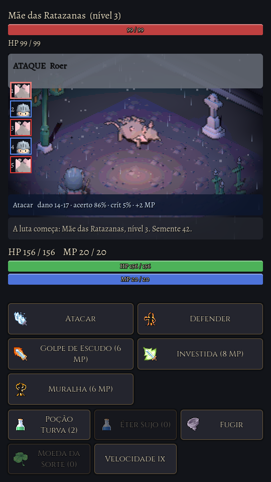 | 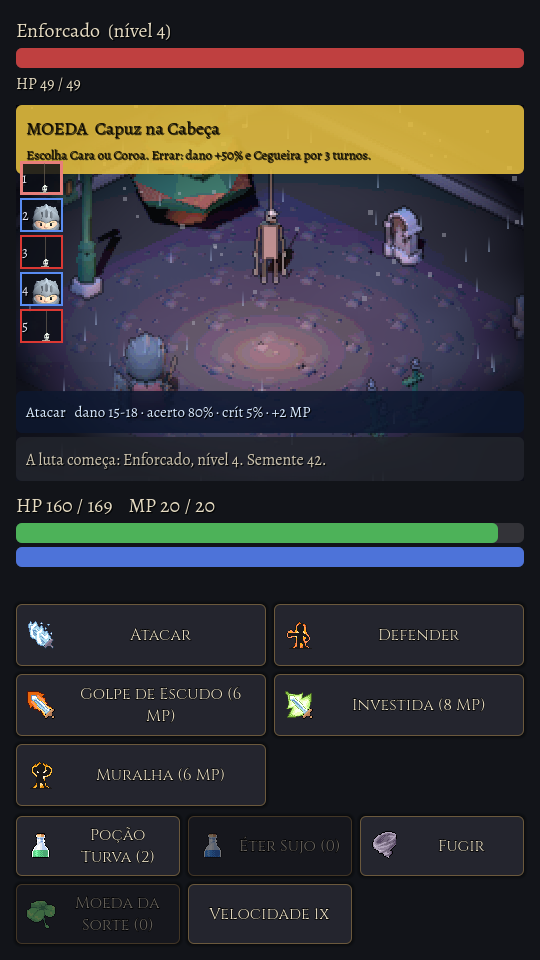 | 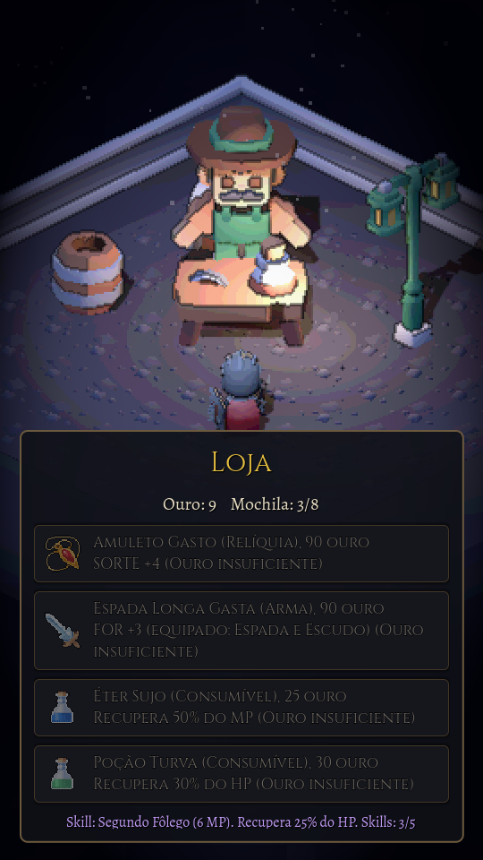 | 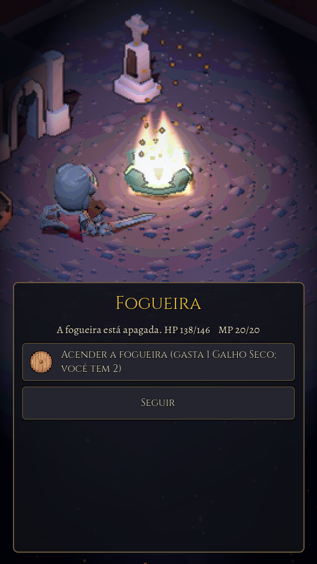 |

| Mapa atual | Recompensa atual | Tela inicial atual | Tela de resultado atual |
| :---: | :---: | :---: | :---: |
| 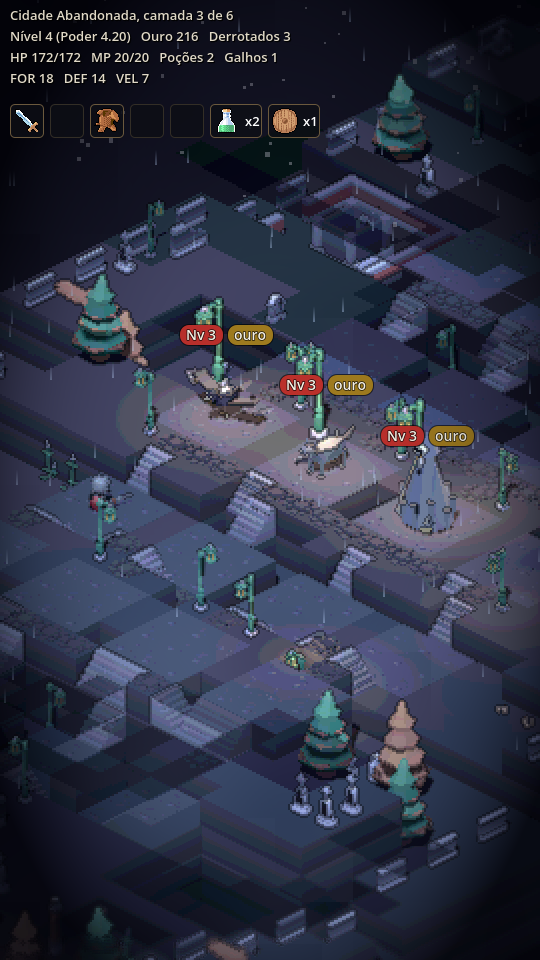 | 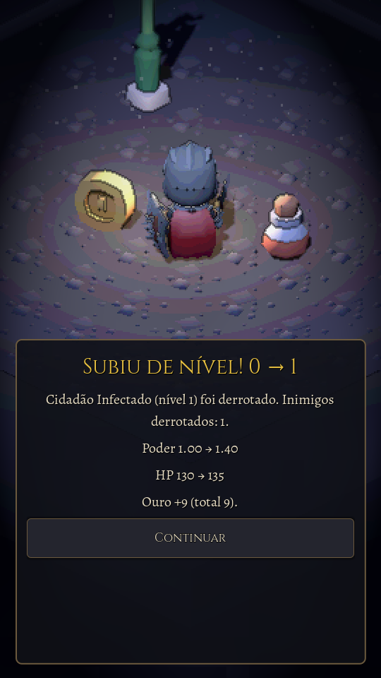 | 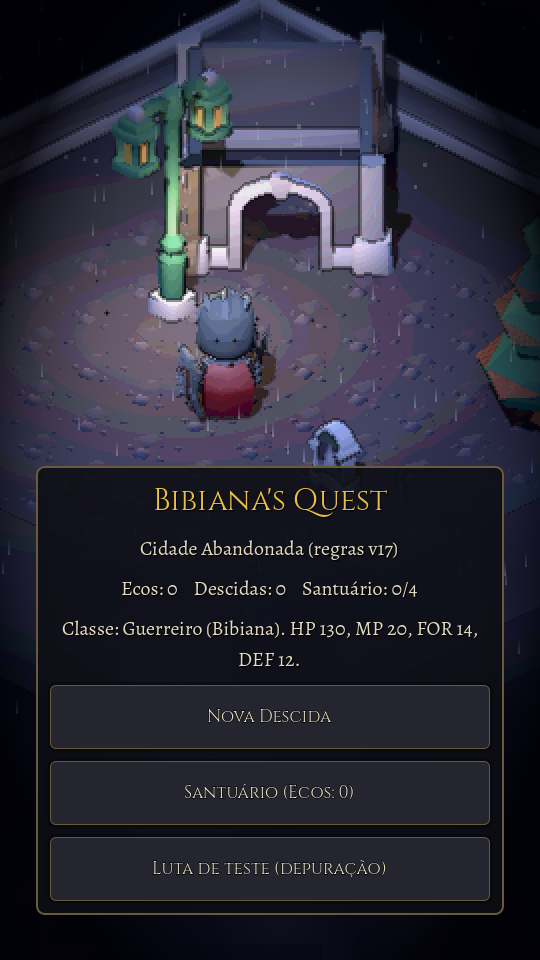 | 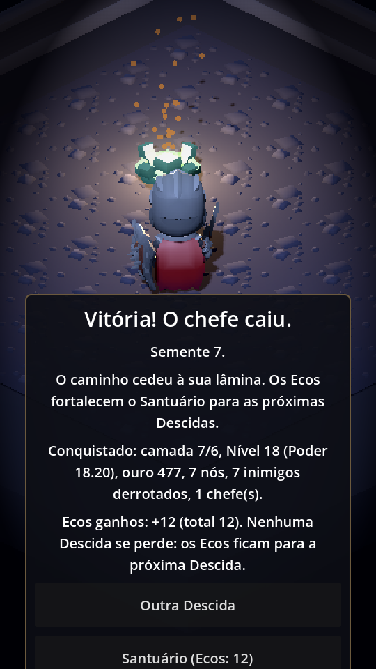 |

### 1.2 Mapa de falhas comprovadas no código (`game/presentation/`)

| Tela / Arquivo | Evidência no código | Por que fica estranho, engessado ou ruim no mobile |
| --- | --- | --- |
| **Combate: palco asfixiado** (`combat_screen.gd:542-548`, `797-835`; `combat3d_stage.gd:11-15,45`) | `_stage.custom_minimum_size = Vector2(0, 330)` em 960 px de altura; `_move_hud_into_stage()` coloca `_intent_panel` dentro do topo do palco e `forecast_panel` + `log_panel` dentro da base do palco. | O palco tem 330 px brutos (~34%), mas o HUD interno ocupa ~70 px em cima e ~85 px embaixo. Sobra apenas **~160–185 px úteis (~17–19% da tela)** para mostrar a Bibiana, o inimigo e o cenário. Com `CAM_SIZE = 5.8`, o inimigo vira uma miniatura distante no centro de uma fresta horizontal. |
| **Combate: banner de Moeda tampa inimigo** (`combat_screen.gd:301-312, 807-808`) | `_intent_panel` expande em largura total no topo quando o texto da moeda tem 2 linhas (como visto em `TASK-047-hanged_man.png`). | O bloco amarelo chapado corta a corda/cabeça de inimigos altos (`Enforcado`, `Carcereiro do Sino`) e gera contraste agressivo fora do mundo 3D. |
| **Combate: duplicação de dados** (`combat_screen.gd:369-382, 535-540, 591-599, 768-778`) | `_enemy_hp_bar` mostra `"99 / 99"` dentro e `_enemy_hp_label` repete `"HP 99 / 99"` logo abaixo; `_player_stats` repete `"HP 156 / 156 MP 20 / 20"` acima das barras que já exibem os mesmos números. | Desperdiça ~55 px verticais nobres repetindo texto idêntico, aumenta ruído visual e empurra o palco ainda mais. |
| **Combate: parede de 11–12 botões cinzas** (`combat_screen.gd:603-636`) | `grid` (2 colunas) empilha 7 botões (`Atacar`, `Defender`, `skill_0..4`) deixando buracos vazios assimétricos quando há 3–4 skills; `utility` (3 colunas) empilha mais 5 (`Poção`, `Éter`, `Fugir`, `Moeda da Sorte`, `Velocidade 1x`). | Todos têm a mesma moldura cinza (`DarkTheme` único) e tamanho parecido. Em uma descida sem Poção/Éter/Moeda, 40% da área inferior vira botão apagado inútil ocupando a zona nobre do polegar. `Velocidade 1x` está na mesma hierarquia de `Fugir` e `Poção`. |
| **Combate: preview quebrado no toque** (`combat_screen.gd:836-840`) | `_forecast` atualiza apenas via `mouse_entered` e `focus_entered`. | **Em tela sensível ao toque (Android/iOS) não existe hover.** Tocar no botão já dispara `perform(action)` na hora; o jogador de celular nunca lê o dano antes de bater. |
| **Loja / Painéis: caixa preta rígida** (`run_panel_screen.gd:30-53, 155-190, 277-293`) | `panel` fixo em `anchor_top = 0.5, anchor_bottom = 0.98`; cada item é um `Button` inteiro com 2–3 linhas de texto corrido em CAIXA ALTA pela fonte Cinzel (`AMULETO GASTO (RELÍQUIA), 90 OURO... (OURO INSUFICIENTE)`). | Cinzel é fonte de título (all-caps/small-caps), péssima para parágrafos longos dentro de botão. A lista vertical não destaca preço, raridade, nem comparação clara — parece formulário de sistema, não interface de RPG. |
| **Fogueira: estado desconectado do 3D** (`run_panel_screen.gd:195-204`; `scene3d_backdrop.gd:189-195`) | `RunPanelScreen` avisa `"A fogueira está apagada"`, enquanto `Scene3DBackdrop._build_campfire()` sempre instancia fogo vivo, brasas e luz quente. | Quebra de imersão imediata: a cena mostra fogueira acesa enquanto a UI diz que está apagada. |
| **Loja: mercador é o chefe Coveiro** (`scene3d_backdrop.gd:208`) | `_build_shop()` chama `ModelRegistry.spawn("gravedigger")` após a TASK-047 ter substituído o boneco antigo pelo horror do chefe final. | Mesmo antes da revisão estética, usar o modelo do chefe final como mercador confunde o jogador sobre quem é o inimigo. |
| **Mapa 3D: HUD solto e bolhas colidindo** (`map3d_screen.gd:88-101, 391-424, 606-646`) | `_header` é um `Label` solto sem fundo/moldura no canto superior esquerdo; `_gear_row` usa quadrados de 30×30 px com `tooltip_text` (desktop-only). | No celular, `tooltip_text` não abre ao tocar; os ícones de 30 px ficam abaixo do mínimo de 48 px; as pílulas `Nv 3` + `ouro` sobrepõem os modelos dos inimigos e postes no diorama. |
| **Home / Fim / Santuário** (`game_screen.gd:112-138, 348-371, 471-505`; `sanctuary_screen.gd:51-190`) | Home mostra dados técnicos (`regras v20`, `HP 130, MP 20`) e botão de depuração no mesmo nível de `Nova Descida`; Resultado transborda para fora da janela cortando o botão `Santuário` (`TASK-038-tela-result.png`); Santuário não usa cena 3D de fundo e desenha abas `[Biblioteca]`. | Falta hierarquia de CTA principal vs secundário, falta scroll seguro na tela de fim em `540×960`, e falta presença tátil/visual no Santuário. |
| **Tema único sem estado nem feedback** (`dark_theme.gd:80-95`) | Um único `StyleBoxFlat` cinza para todo `Button` do jogo; zero animação de pressão (`scale`), zero barra fantasma de dano, zero transição de gaveta. | Tudo responde como caixa de diálogo de protótipo ("engessado"). |

---

## Parte 2 — Estudo Comparativo de Interfaces Mobile (RPGs, Roguelikes e Táticos)

Foram analisados **9 jogos de referência** (11 telas verificadas) cobrindo RPGs dark fantasy em retrato, roguelikes mobile, deckbuilders/táticos de bolso e JRPGs táticos modernos.

### 2.1 Galeria de referências analisadas

#### A. Roguelikes & RPGs Dark Fantasy em Retrato Mobile

| *Buriedbornes2* (Combate Retrato) | *Buriedbornes2* (Mapa de Nós) | *Dawncaster* (Combate) | *Dawncaster* (Cartões de Recompensa) |
| :---: | :---: | :---: | :---: |
| 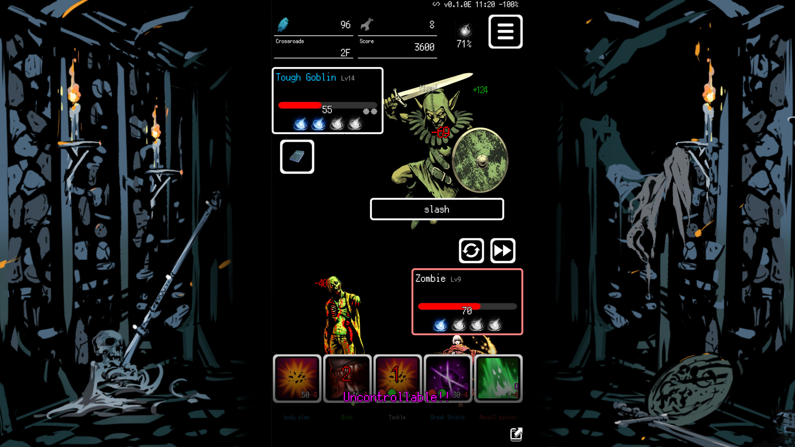 | 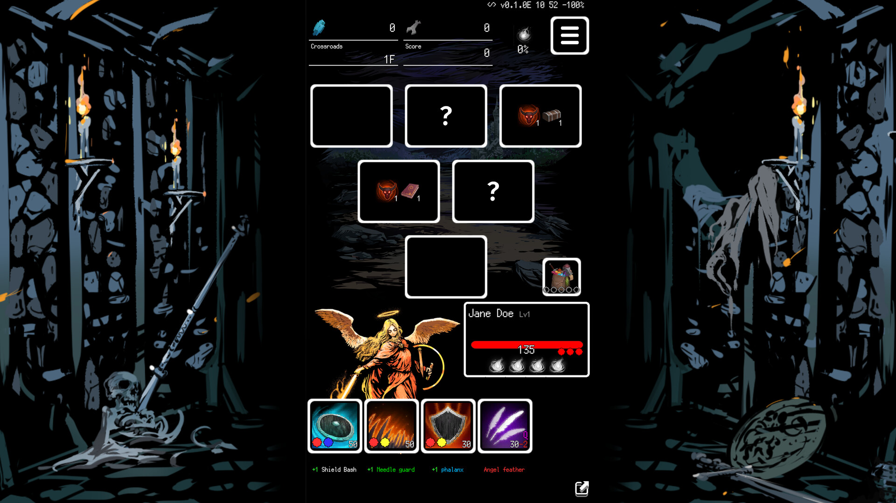 | 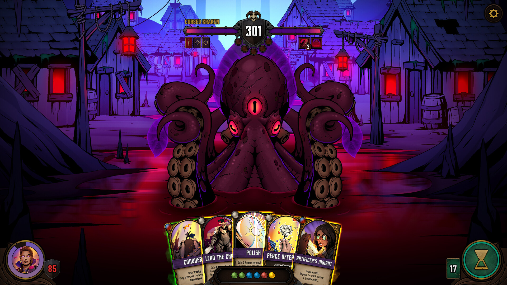 | 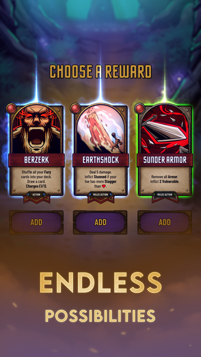 |

- **Buriedbornes2**: prova que um roguelike dark fantasy sombrio funciona em retrato com **~55% de palco central limpo** para o inimigo, barra compacta no topo do monstro (com status/orbes embaixo da barra, não cobrindo o corpo) e **5 slots quadrados táteis** alinhados na base ao alcance do polegar. No mapa (`ui-buriedbornes2-mapa.jpg`), os destinos são cartões claros sobre fundo escuro com ícones imediatos de recompensa/perigo.
- **Dawncaster**: mestre de UX mobile em retrato. A barra do inimigo fica ancorada no topo absoluto como ornamento de ferro, com intenção/buffs agrupados discretamente logo abaixo, liberando todo o centro para a criatura e o cenário. Nas recompensas (`ui-dawncaster-recompensa.png`), compara **3 cartões lado a lado** com cor de raridade na borda e botão tátil dedicado embaixo — substituindo listas longas de texto por escolha visual imediata. Em combate mobile, **segurar/tocar** amplia o cartão acima do dedo para leitura sem obstrução.

| *Night of the Full Moon* (Retrato) | *Shattered Pixel Dungeon* (HUD Mobile) | *Slice & Dice* (Retrato 9:16) | *Fear & Hunger* (Proporção de Palco) |
| :---: | :---: | :---: | :---: |
| 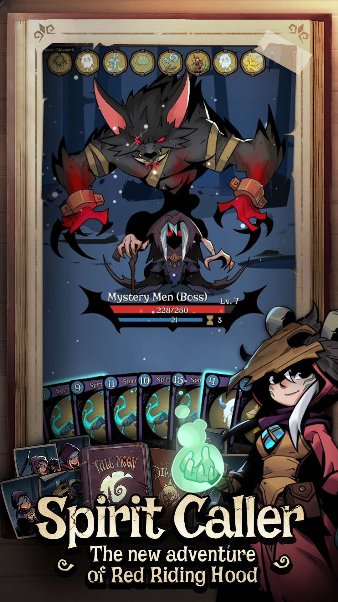 | 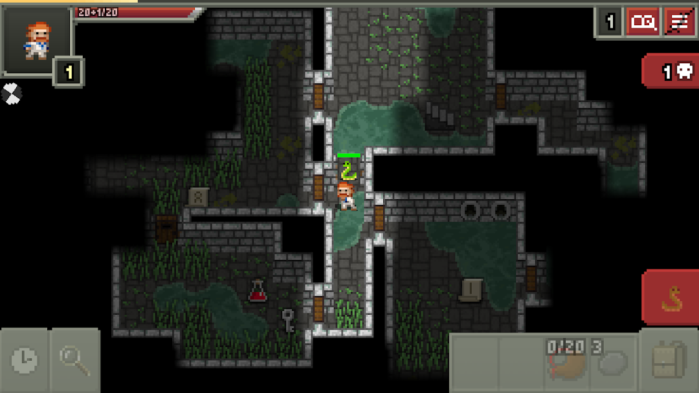 | 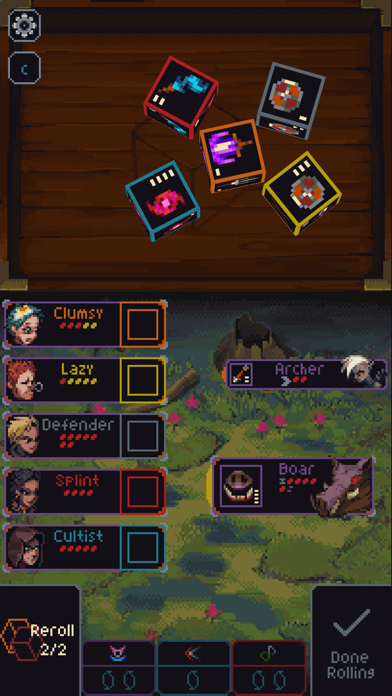 | 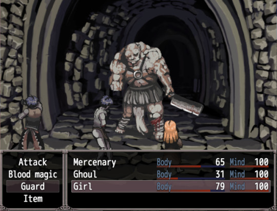 |

- **Night of the Full Moon**: excelente uso da silhueta imponente na metade superior + placa única compacta separando o palco das ações na metade inferior.
- **Shattered Pixel Dungeon**: referência ouro de **HUD ancorado nas extremidades**. Em vez de cercar a tela com molduras pesadas, coloca retrato + HP no canto superior esquerdo, menu/andar no canto superior direito, alerta contextual de inimigo na lateral direita e apenas os slots de acesso rápido no canto inferior direito — deixando **85%+ da área visual para o cenário**.
- **Slice & Dice**: referência absoluta em **zero menus escondidos e proteção contra toque acidental**. No retrato (`ui-slice-and-dice.png`), a barra de rolagem/ações principais fica no terço inferior com alvos gigantes nos cantos esquerdo e direito (`Reroll` / `Done Rolling`), e os retratos de aliados + inimigos exibem suas ações/intenções como ícones + pips numéricos em linha. Tocar inspeciona; confirmar exige ação intencional; há `Undo` imediato em seleções reversíveis.
- **Fear & Hunger**: define a proporção dramática que o Bibiana's Quest quer em combate — **70–75% da altura dedicada ao corredor escuro e ao inimigo colossal**, com luz concentrada no centro e um bloco retangular enxuto de ações e status na base.

#### B. Jogos Táticos de Tabuleiro e JRPGs Mobile (Square Enix & afins)

| *Fire Emblem Heroes* (Tabuleiro Retrato) | *Sword of Convallaria* (Previsão & Mundo) | *Octopath Traveler: CotC* (Mobile Square Enix) |
| :---: | :---: | :---: |
| 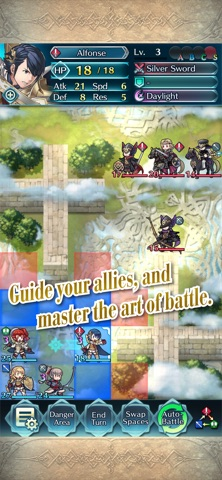 | 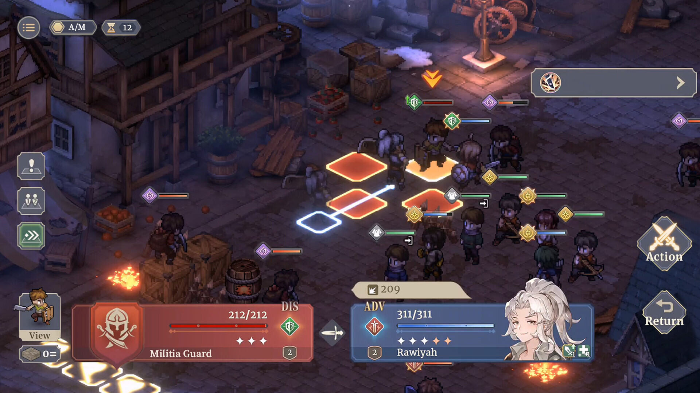 | 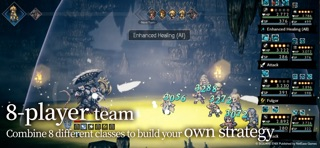 |

- **Fire Emblem Heroes**: resolve tático em retrato dividindo a tela em **faixa estreita de inspeção no topo (~14%)**, **tabuleiro limpo no centro (~74%)** e **dock inferior de 5 botões táteis (~12%)**. Nada de texto corrido sobre o mapa.
- **Sword of Convallaria**: referência direta para nosso **painel de previsão de combate** e **ícones sobre o mundo**. Em vez de escrever frases em botão, coloca ícones de vantagem/buff sobre a cabeça dos personagens no cenário e um painel frente a frente compacto comparando Atacante vs Alvo + número grande de dano previsto (`209`).
- **Octopath Traveler: CotC**: mostra como a Square Enix adapta combate de turnos em diorama HD-2D para tela de toque — empurra os controles compactos para a borda (ou base, em retrato) mantendo o centro do palco 100% respirável para animações e partículas.

### 2.2 Tabela Comparativa de Padrões

| Jogo | Proporção Palco / UI | Como lida com Info Densa no Mobile | Principal lição para *Bibiana's Quest* | O que **não** copiar |
| --- | :---: | --- | --- | --- |
| **Buriedbornes2** | ~58% / 42% | Barra no topo do inimigo + 5 botões quadrados com cooldown/custo | Ícones quadrados grandes na base + mapa de cartas | Fundo preto chapado sem profundidade 3D; bordas brancas duras |
| **Dawncaster** | ~60% / 40% | Header ornamental fino + ações em leque/cartão na base | Cartões de recompensa/loja comparáveis + toque que amplia preview | Estética limpa/vibrante de fantasia alta |
| **Slice & Dice** | ~65% / 35% | Ícones + números curtos ao lado de cada unidade; zero frases | Clareza instantânea de intenção sem texto; botões nos cantos inferiores | Pixel art 2D puro sem palco 3D |
| **Shattered Pixel Dungeon** | ~85% / 15% | HUD mínimo nos 4 cantos; mochila abre em gaveta sob demanda | Tirar inventário/status da tela fixa usando gaveta tátil no mapa | Estética pixelada rígida de janela cinza |
| **Fire Emblem Heroes** | ~74% / 26% | Strip de ficha compacta no topo ao tocar unidade; 5 botões embaixo | Dock inferior enxuto de 5 botões + inspeção sob toque no mapa | Visual anime colorido e grade de movimento |
| **Sword of Convallaria** | ~78% / 22% | Badges de estado sobre as cabeças + card frente-a-frente de dano | Preview visual `Dano / Acerto / Crítico` em strip limpo, sem texto em botão | HUD de múltiplos personagens simultâneos |
| **Fear & Hunger** | ~75% / 25% | Menu de 4 verbos na base + barras Body/Mind finas | Inimigo monumental dominante + luz no chão + silêncio visual | Falta de botões grandes (FEH é feito para PC/teclado) |

### 2.3 As 8 Leis de Ouro da UI Mobile Retrato para *Bibiana's Quest* (540×960)

1. **Mapa Ergonômico do Polegar (Steven Hoober em 540×960):**
   - `Y = 0..88 px` (~9%): **Zona Somente-Leitura** (nome, HP do inimigo, andar/camada, ouro, botão discreto de som/pausa no canto). Nunca exigir toques frequentes aqui.
   - `Y = 88..636 px` (~57%): **Zona do Palco 3D** (mundo vivo, inimigo grande, Bibiana, intenção flutuante e linha do tempo enxuta na margem esquerda). Zero painéis bloqueando o centro.
   - `Y = 636..960 px` (~34%): **Zona Natural do Polegar** (barras da Bibiana, strip de preview, botões principais e gavetas).
2. **Regra dos 55%+ de Palco Livre:** o inimigo e a atmosfera precisam respirar. Se uma barra ou faixa de log reduz o palco para menos da metade da tela, a informação deve ser condensada em ícone ou movida para gaveta sob demanda.
3. **Substituir Hover por "Toque 1 = Selecionar / Toque 2 = Confirmar" (ou Segurar 300ms):**
   - No celular não há `mouse_entered`. A primeira interação precisa mostrar a previsão (`14-17 dano • 87% acerto • 5% crít • +2 MP`) sem gastar o turno por acidente; a segunda confirma — **ou** toque curto executa e segurar 300 ms inspeciona (ponto de decisão D-UI-1 para o Orlando).
4. **Dock Categorizado (5 botões visíveis em vez de 12):** *Atacar* e *Defender* ficam sempre acessíveis em 1 toque como botões primários largos (56–64 px de altura). *Habilidades*, *Itens* e *Tático* (`Fugir`, `Moeda da Sorte`, `2x`) abrem uma bandeja deslizante limpa na mesma área inferior sem cobrir o inimigo.
5. **Bottom Sheets Deslizantes e Cartões Visuais em Loja/Fogueira/Evento:** substituir botões de texto corrido por cartões com ícone à esquerda/topo, título curto em Alegria/Cinzel leve, badge colorido de delta (`+3 FOR ▲`), e selo de preço dourado no canto.
6. **Zero Redundância de Texto:** eliminar labels duplicados de HP/MP fora das barras e remover o sufixo `(OURO INSUFICIENTE)` de dentro do texto do botão — usar estado visual claro (selo de preço em vermelho escuro + cartão esmaecido).
7. **Hierarquia Visual por Categoria de Ação:**
   - **Primário / Combate:** borda bronze iluminada / acento carmesim ou dourado.
   - **Secundário / Gaveta:** pedra escura com borda bronze discreta.
   - **Risco / Moeda:** âmbar envelhecido com ícone de medalhão.
   - **Desabilitado:** contraste reduzido limpo, sem texto de desculpa espremido.
   - Todo alvo clicável com mínimo **48×48 px** (ideal **56–64 px** para ações primárias e **8–10 px** de separação para evitar miss-tap).
8. **Micro-interações e Juice Tátil:** compressão no toque (`scale 0.96` em 60 ms), barra fantasma branca/dourada que escorrega em 350 ms atrás do dano real na barra de HP, vibração leve (`Input.vibrate_handheld(25)`) em acertos/críticos/moeda, e transições rápidas (`180 ms`, `TRANS_CUBIC / EASE_OUT`) para o jogo nunca parecer lento nem travado.

---

## Parte 3 — Proposta Completa de Reformulação da UI (Tela por Tela)

### 3.1 Conceito Visual da Nova Tela de Combate (Nano Banana)

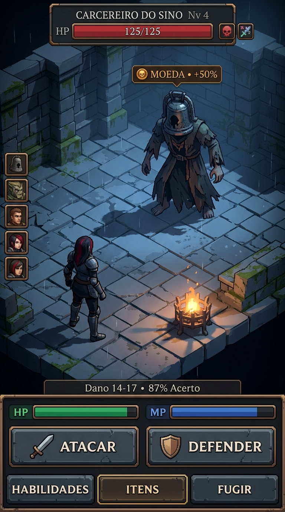

> **Nota de fidelidade sobre o mockup conceitual:** A imagem gerada ilustra perfeitamente a proporção de palco (**~58% da tela livre**), a hierarquia limpa no topo e o dock tátil no polegar. Na implementação real no Godot: (1) a coluna de linha do tempo à esquerda exibe apenas retratos alternados da **Bibiana** e do **inimigo atual** (combate 1v1, GDD §6), nunca personagens extras; (2) a faixa superior de HP tem cantos consistentes e mantém o ícone de mudo discreto no canto superior direito. *(Observação transparente: o segundo mockup conceitual para Loja/Fogueira atingiu o limite temporário de cota de 5h da ferramenta de imagem `429 RESOURCE_EXHAUSTED`, portanto os fluxos de Loja, Fogueira, Mapa e Santuário estão especificados nos wireframes precisos em 540×960 abaixo junto às referências reais de mercado.)*

### 3.2 Especificação por Tela (Grade Base `540×960` + `SafeArea`)

#### 1. Tela de Combate (`CombatScreen` + `Combat3DStage`)

**Ganho estrutural:** o palco salta de **~170 px úteis (18%)** para **~548 px úteis (57%)**, enquanto `CAM_SIZE` cai de `5.8` para `~4.2–4.5` e a câmera se aproxima do inimigo para que chefes e horrores preencham o quadro com presença física real.

```text
+--------------------------------------------------+ Y=0
| [Sino/Mudo]  CARCEREIRO DO SINO   Nv 4   [Skull] |
| [======= HP 125 / 125 =======]  (trail de dano)  |  <- 76 px (8%) Somente-leitura
+--------------------------------------------------+ Y=76
| [1][I]                              [Debuffs]    |
| [2][B]         (MOEDA • +50% Cegueira)           |
| [3][I]                 ^                         |
| [4][B]          [ INIMIGO 3D GRANDE ]            |  <- 548 px (57%) PALCO 3D LIVRE
| [5][I]                                           |     (Zero log fixo / Zero barra opaca)
|                       o                          |
|     [Bibiana 3D]   (Luz no chao)                 |
|  "Bibiana causou 16 de dano!"   (ticker fade 2s) |
+--------------------------------------------------+ Y=624
| [HP  156/156  ====]   [MP  20/20  ====] [Buffs]  |  <- 46 px
|  Atacar • 14-17 dano • 87% acerto • +2 MP        |  <- 34 px Strip de Previsao (tap/hold)
| +----------------------+ +---------------------+ |
| |  [Espada] ATACAR     | | [Escudo] DEFENDER   | |  <- 68 px Acoes Primarias (1 toque)
| +----------------------+ +---------------------+ |
| +-------------+ +-------------+ +--------------+ |
| | HABILIDADES | |   ITENS (2) | |  TATICO [2x] | |  <- 56 px Gavetas + Atalhos
| +-------------+ +-------------+ +--------------+ |
+--------------------------------------------------+ Y=960 (respeitando margin bottom SafeArea)
```

**Mudanças-chave de interatividade no Combate:**
- **Intenção Flutuante (`world-space`)**: um badge fino acima da cabeça do inimigo (via `camera.unproject_position`) com ícone grande + tag curta (`ATAQUE • 14`, `MOEDA • +50% + Cegueira`, `DEBILITA • 60% Veneno`). Tocar no inimigo ou no badge abre um popover rápido explicando o golpe e a reação sem cobrir a tela toda.
- **Linha do Tempo compacta**: chips de `32×32 px` com moldura azul (Bibiana) / vermelha (Inimigo) encostados na borda esquerda (`X = 6 px`), apenas 4 turnos, sem números grandes desperdiçando largura.
- **Ticker de Combate + Histórico Opcional**: em vez de uma caixa fixa de 7 linhas (`_log_label`), apenas a última linha aparece em fade suave por 2,2 s na borda inferior do palco; tocar no ícone discreto de pergaminho/lupa abre um drawer translúcido com o log completo.
- **Bandeja Deslizante (Sem sair da luta)**:
  - Tocar em **Habilidades (N)** desliza um grid 2×2 ou 3×2 cobrindo apenas os ~130 px da zona inferior com ícone, nome curto, custo `6 MP` em pílula azul e badge de dano `18-22`.
  - **Fluxo de decisão sem hover (proposto)**:
    - *Modo A (Recomendado para mobile):* Tocar uma vez na Habilidade seleciona e ilumina o Strip de Previsão (`"Golpe de Escudo • 12-15 dano • 85% • Moeda: Atordoa"`) e muda o botão para estado armado com brilho dourado; **segundo toque confirma e executa** (ou tocar em outro botão troca a seleção sem erro). *Atacar* e *Defender* podem ser confirmados em 1 toque (ou 2, configurável).
    - *Modo B (Alternativo):* Toque curto executa imediato; segurar (`long-press` 280 ms) abre o preview flutuante acima do dedo.
- **Ritual Dramático da Moeda (`_show_coin`)**: em vez de abrir uma janela genérica no meio com texto simples, o palco escurece em vinheta 75%, a câmera fecha (`CAM_SIZE * 0.72`) no espaço entre a Bibiana e o inimigo, o medalhão 3D/2D aparece grande no centro, uma faixa mostra a aposta real (`Risco: Dano +50% e Cegueira`), e na base do polegar sobem dois **botões monumentais lado a lado (`CARA` [Sol Dourado] / `COROA` [Cruz Carmesim]) + pílula opcional `Armar Moeda da Sorte (1)`**.

#### 2. Tela do Mapa 3D (`Map3DScreen`)

```text
+--------------------------------------------------+ Y=0
| Cidade Abandonada • 3/6      [Ouro 216] [Som]    |  <- Barra superior compacta (44 px)
| [HP 156/156 ====]  [MP 20/20 ===]  [Nv 4 • 4.2]  |  <- 42 px translucida escura (blur/borda)
+--------------------------------------------------+ Y=86
|                                                  |
|          [Chefe distante na nevoa]               |
|                                                  |
|        (Nv 3 • Elite)   (Bau)   (Fogueira)       |  <- 790 px Tabuleiro 3D Livre
|              \            |         /            |     (Bolhas limpas: [Icone+Nv3] sem frases)
|                   [ Bibiana ]                    |
|                                                  |
+--------------------------------------------------+ Y=876
| [Mochila / Equip (5/5)]  [Pocoes x2] [Galho x1]  |  <- 84 px Dock inferior fixo do mapa
+--------------------------------------------------+ Y=960
```

**Mudanças-chave no Mapa:**
- **Fim do texto solto no canto**: o cabeçalho vira uma barra superior limpa com fundo escuro semitransparente (`rgba(12,13,17,0.88)`) e borda inferior de bronze fino.
- **Bolhas de nó enxutas**: trocar pílulas longas (`"equip. raro"`, `"raro garantido"`) por ícone de nó + 1 dado (`[Espada] Nv 3`, `[Bau]`, `[Chama]`, `[Crânio] Nv 4`).
- **Prévia tátil em 2 passos (evita morte por toque acidental)**:
  - **Toque 1** em um dos 3 destinos: a câmera desliza suavemente na direção do nó (`CAM_LOOKAHEAD`), acende o caminho e sobe um **mini-card de 130 px no rodapé** mostrando: *Nome do Inimigo + Retrato + Nível + Mutação + Recompensa esperada* e um botão largo **`CAMINHAR ATÉ AQUI`** (ao lado de `Cancelar` / tocar fora). Assim o jogador explora as 3 rotas antes de se comprometer, exatamente como em *Slay the Spire* / *Buriedbornes2*.
- **Gaveta de Equipamento e Status no Polegar**: tocar na barra `[Mochila / Equip]` abre um bottom-sheet mostrando os 5 slots equipados (`Arma`, `Mão Sec.`, `Armadura`, `Cabeça`, `Relíquia`), consumíveis, doenças ativas e atributos totais (`FOR`, `DEF`, `VEL`, `CRIT`, `SORTE`) com descrições reais legíveis no celular.

#### 3. Loja (`RunPanelScreen` modo `shop`)

O diorama 3D do mercador sob lampião ocupa os **44% superiores** (desobstruído). A metade inferior (**56%**) vira um **Bottom Sheet** com aba de arrasto visual, cabeçalho fixo (`LOJA`, badge de ouro dourado, contador `Mochila 3/8`) e **grade 2×2 de Cartões de Item** em vez de botões largos de texto:

```text
+--------------------------------------------------+
|          [ DIORAMA 3D DO MERCADOR ]              |  <- 420 px (44%)
+--------------------------------------------------+ Y=420
|  ---   LOJA DO BECO          [216 Ouro]  [3/8]   |  <- Bottom Sheet (540 px)
| +----------------------+ +---------------------+ |
| | [Icone] Espada Longa | | [Icone] Amuleto     | |
| | Arma   +3 FOR (▲)    | | Reliquia  +4 SORTE  | |  <- Cartoes 2x2 limpos
| |       [ 90 Ouro ]    | |       [ 90 Ouro ]   | |     (Borda por raridade)
| +----------------------+ +---------------------+ |
| +----------------------+ +---------------------+ |
| | [Icone] Pocao Turva  | | [Icone] Seg. Folego | |
| | Cura 30% HP          | | Skill • 6 MP        | |
| |       [ 30 Ouro ]    | |       [ 120 Ouro ]  | |
| +----------------------+ +---------------------+ |
| [Atualizar 25]        [ SEGUIR ADIANTE  -> ]     |  <- Acoes fixas no rodape
+--------------------------------------------------+
```

- **Toque no cartão** abre um card compacto de confirmação/comparação mostrando o item equipado atual vs o novo atributo por atributo (`FOR 14 → 17 ▲`, `VEL 7 → 6 ▼`) e o botão **`COMPRAR E EQUIPAR (90 Ouro)`** (ou `Vender antigo` automático). Itens acima do ouro atual mostram o selo de preço em vermelho escuro sem poluir o cartão com texto `(OURO INSUFICIENTE)`.

#### 4. Fogueira (`RunPanelScreen` modo `campfire`)

- **Sincronia real com o 3D**: quando `view["lit"] == false`, `Scene3DBackdrop` mostra **apenas o braseiro com cinzas frias e fumaça leve** sob lua azulada (sem chama nem luz laranja!). Ao tocar em **`ACENDER FOGUEIRA (1 Galho)`**, um fade/clarão acende o fogo 3D com partículas de brasa e aquece a cena inteira.
- **Pinos visuais de Brasas**: no topo do sheet da fogueira, exibir 6 ícones de brasas acesas/apagadas (`● ● ● ○ ○ ○ 3/6 Brasas`) em vez de só texto corrido.
- **Cartões em linha** com custo de Brasas em badge laranja-brasa, efeito em 1 linha (`Cura 40% HP e MP`, `+20% CRIT por 3 lutas`, `Cura Leptospirose`), e botão compacto `Seguir` no rodapé.

#### 5. Baú, Recompensa, Evento e Tela de Resultado

- **Baú**: mostra o multiplicador `×1.75` grande flutuando sobre o baú 3D aberto (via `unproject_position`), e na base apenas os 2 botões largos de ação (`Usar Moeda da Sorte`, `Anúncio Opcional`) + `Recolher e Seguir`.
- **Recompensa pós-luta**: cabeçalho limpo `VITÓRIA` (e banner dourado `NÍVEL 1!` quando subir), pílulas compactas de ganho (`+0.40 Poder`, `+9 Ouro`, `HP 130 → 135`) + cartão único do drop com comparação direta (`Equipar & Vender antigo` lado a lado com `Vender por X ouro`).
- **Eventos de Mapa**: descrição em Alegreya `18 px` dentro de caixa com `ScrollContainer` de altura máxima limitada + botões de escolha com **badges à direita** indicando risco (`[Moeda]`, `[-15 Ouro]`, `[Seguro]`).
- **Resultado (Vitória / Derrota)**: corrigir o corte visto em `TASK-038-tela-result.png` colocando o conteúdo resumo dentro de um `ScrollContainer` flexível acima dos botões fixos (`Outra Descida` em destaque primário dourado; `Santuário` e `Início` em linha secundária).

#### 6. Menu Inicial (`Home`) e Santuário (`SanctuaryScreen`)

- **Home**: o diorama 3D da Bibiana sob a chuva na entrada da cidade ocupa **100% do fundo sem caixa opaca esmagando o centro**. Em cima: título limpo `BIBIANA'S QUEST` + subtítulo atmosférico (`A Cidade Abandonada`). No terço inferior:
  - CTA principal grande (64 px, borda dourada): **`CONTINUAR DESCIDA`** (se houver save) ou **`NOVA DESCIDA`**.
  - Linha secundária (2 botões lado a lado, 54 px): **`SANTUÁRIO (Ecos)`** e **`CLASSE: GUERREIRO`** (preparando o espaço da TASK-049).
  - Barra discreta no canto superior esquerdo/direito para ícone de **Som** e ícone de **Engrenagem/Debug** (onde ficam `regras v20`, semente manual e `Luta de teste` em builds de debug, tirando lixo técnico da frente do jogador).
- **Santuário**: ganha cena 3D própria ao fundo (Bibiana diante de altar/cripta em ruína), abas segmentadas reais (`StyleBoxFlat` ativa com sublinhado dourado, sem `[colchetes]`), e **Bestiário com retratos 3D/miniaturas** dos inimigos + selos de descoberta e ícone da consequência da moeda.

### 3.3 Tokens do Novo Design System (`DarkTheme 2.0`)

| Token | Valor / Regra | Uso |
| --- | --- | --- |
| `BG_GLASS` | `#0B0C10` com `alpha 0.90` | Fundo de bottom-sheets e barras HUD |
| `SURFACE_CARD` | `#161820` | Cartões de loja, fogueira e skills |
| `SURFACE_ELEVATED` | `#1F222C` | Cartão selecionado / estado ativo |
| `BORDER_BRONZE` | `#6B593D` (`1 px`) | Borda padrão de painéis e botões secundários |
| `BORDER_GOLD` | `#EBBF42` (`2 px`) | CTA primário, item selecionado, turno ativo |
| `ACCENT_BLOOD` | `#8F2420` (fill) / `#D93832` (borda) | Ações ofensivas / alerta de perigo / preço insuficiente |
| `ACCENT_AMBER` | `#D4882A` | Moeda, intenção de risco, brasa |
| `DELTA_UP` / `DELTA_DOWN` | `#57B86A` / `#D9534F` | Badges de comparação de atributos (`▲` / `▼`) |
| `FONT_TITLE` / `FONT_BODY` | Cinzel `600/700` só títulos e botões curtos (≤ 3 palavras); **Alegreya `500`** para tudo descritivo e números | Acaba com parágrafos cansativos em CAIXA ALTA |
| `MIN_TOUCH` | `48×48 px` mínimo absoluto; `56–64 px` em CTAs; `8–10 px` gap | Ergonomia em celular (GDD §19) |
| `SAFE_AREA` | Ler `DisplayServer.get_display_safe_area()` no `_ready()` do container raiz | Evita recorte por notch/câmera frontal e barra de gestos Android |

### 3.4 Roteiro Sugerido de Implementação Pós-Aprovação (4 Tarefas Incrementais)

1. **Ui-A — Design System & Componentes Base**: refazer `DarkTheme` com variantes (`PrimaryButton`, `DangerButton`, `CardPanel`, `BottomSheet`, `StatDeltaBadge`), `SafeArea` wrapper, e barra de HP/MP com trail de dano animado.
2. **Ui-B — Combate Mobile-First**: rearranjar `CombatScreen` (57% palco, remoção de texto duplicado e log fixo), aproximar `Combat3DStage`, mover intenção para `world-space`, criar dock categorizado + fluxo de confirmação sem hover + takeover da Moeda.
3. **Ui-C — Menus em Bottom-Sheet (Loja, Fogueira, Recompensa, Baú, Evento, Fim)**: trocar listas verticais por cartões visuais, sincronizar fogueira apagada/acesa no 3D, trocar mercador provisório (`gravedigger`) por modelo próprio de mercador/vulto, corrigir scroll da tela de fim.
4. **Ui-D — Mapa Tátil, Home e Santuário 3D**: barra superior slim + mini-card de prévia em 2 toques no mapa + gaveta de equipamento; Home limpa com debug recolhido; Santuário com fundo 3D e retratos no Bestiário.

---

## Parte 4 — Bestiário Proposto: 8 Inimigos Dark Fantasy Perturbadores (Estilo FFT / Square Enix 3D)

### 4.1 Princípios de Design Dark Fantasy Perturbador (GDD §3 e §13)

Inspirando-se na linhagem sombria de *Final Fantasy Tactics* (os Lucavi e o horror religioso de Ivalice), *Vagrant Story* (a carne e o ferro fundidos nas ruínas de Leá Monde), *Fear & Hunger*, *Blasphemous* e *Darkest Dungeon*, os 8 inimigos abaixo buscam **medo psicológico e anatômico sem gore gratuito** (mantendo conformidade etária de loja):
- **Sacralidade e medicina corrompidas:** objetos de fé, cura ou penitência (turíbulo, relicário, velas, roda, órgão, mortalha) crescem *para dentro* ou *para fora* do corpo como parasitas da Febre.
- **Perda de rosto e identidade:** máscaras cravadas, véus com olhos demais, rostos sem boca ou pendurados de cabeça para baixo provocam o efeito *uncanny valley* imediato mesmo em low-poly.
- **Proporções humanas quebradas (não chibi):** membros excessivamente longos, colunas dobradas a 90° ou pontes invertidas criam silhuetas instantaneamente reconhecíveis até em `480×270`.
- **Materialidade de mundo morrendo:** cera derretida, linho molhado, latão oxidado, pedra calcificada e madeira rachada substituem cores lisas.

---

### 4.2 Inimigo 1 — O Turiferário Cego

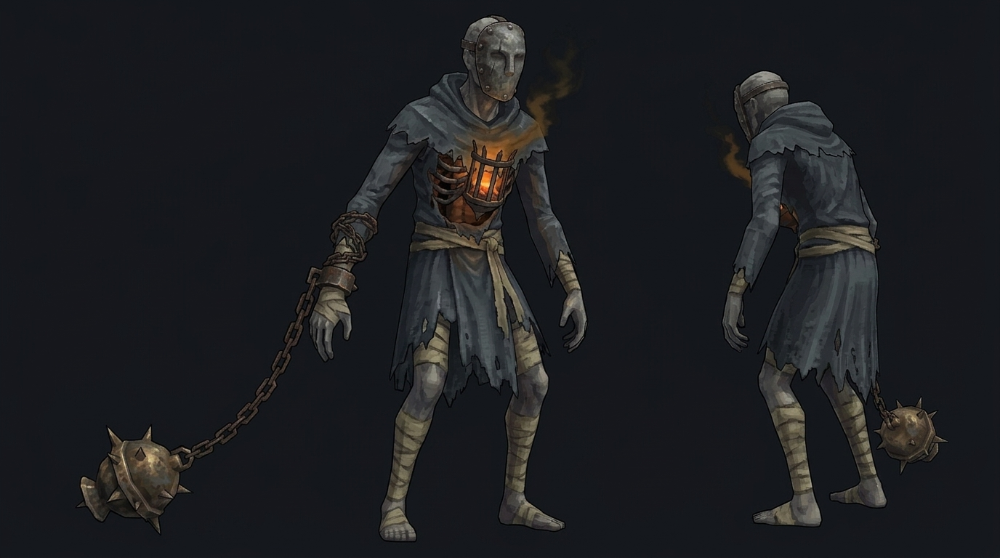

| Campo | Definição |
| --- | --- |
| **Cenário(s)** | Cidade Abandonada (raro) / Catedral dos Sinos (comum) |
| **Tipo sugerido** | Comum ou Elite inicial (nível base 2) |
| **Medo central (1 frase)** | *Ser purificado por um padre cego cujo próprio peito é o forno de incenso da praga.* |
| **Palavras-chave de silhueta** | Máscara de ferro rebitada sem olhos, costelas abertas com braseiro aceso no peito, braço direito anormalmente longo preso por corrente a um turíbulo gigante com espinhos. |

- **Background / Lore:** Durante os primeiros meses da Febre na Cidade Abandonada, sacerdotes voluntários percorriam os quarteirões balançando turíbulos de ervas secas e enxofre para mascarar o cheiro das valas. Quando ficaram cegos pela fumaça tóxica e pelas pústulas, o clero rebitou máscaras de ferro sem orifícios sobre seus rostos para que não recuassem diante dos doentes. Os últimos que sobreviveram à queda dos portões fundiram os próprios braseiros às costelas abertas para que o fogo nunca apagasse — e hoje perseguem qualquer passo vivo para "defumar" o pecado de respirar.
- **Proposta de Mecânica (GDD §7):**
  - *Golpe de Moeda:* **Defumação de Enxofre** (*Heavy/Cruel*). Em **Cara**, apenas dano físico do baque; em **Coroa**, dano +50% e aplica **Cegueira** (ou **Veneno** de fumaça tóxica por 3 turnos).
  - *Reação:* se a Bibiana usar **Defender** duas vezes seguidas, o Turiferário se aproxima e prepara **Braseiro Aberto** (dano de Fogo/Fumaça avisado).
  - *Contra-jogo:* golpe com o turíbulo longo tem acerto menor (fácil de esquivar ou mitigar), mas ignorar os avisos acumula fumaça; ataques rápidos interrompem antes do balanço grande.

#### Especificação IA-Friendly para Reconstrução no Blender

```yaml
enemy_id: blind_censer_bearer
blender_conventions:
  facing: "-Y"
  up: "+Z"
  ground_z: 0.0
  origin: [0.0, 0.0, 0.0]
  target_height_m: 1.95
  triangle_budget: "2200-2900 tris"
  shading: "flat / sharp-edged PS1-PS2 low-poly with beveled silhouettes"
proportions:
  head_to_body_ratio: "1 : 7.5 (tall gaunt human, never chibi)"
  right_arm_extension: "1.45x normal human arm length (reaches knee height before chain)"
parts:
  - name: feet_and_calves
    coords_m: [±0.16, 0.0, 0.0..0.46]
    technique: "bmesh extruded ankle/foot blocks + diagonal spiral plane bands (bandages) wrapped with Shrinkwrap/Offset"
  - name: tattered_cassock_skirt
    coords_m: [0.0, 0.02, 0.35..0.95]
    technique: "10-sided open cylinder flared downward, bottom ring vertices randomly displaced in Z (-0.12m..+0.05m) for jagged wet cloth teeth; slight Solidify (0.015m)"
  - name: hollowed_ribcage_furnace
    coords_m: [0.0, -0.02, 0.95..1.48]
    technique: "torso hull with front Boolean/deleted cavity; 5 curved rib pairs built from Skin modifier on vertical/curved vertex loops; vertical iron cage bars around glowing inner coal core (subdivided icosphere with Displace)"
  - name: iron_mask_and_hood
    coords_m: [0.0, -0.06, 1.56..1.84]
    technique: "low-poly cranial dome + slightly convex faceted faceplate with Bevel (no eye holes), 6 small hexagonal rivet pins around perimeter, draped cowl collar over shoulders"
  - name: elongated_right_arm_and_chain
    coords_m: [-0.28, -0.05, 1.42] -> [-0.42, -0.18, 0.58]
    technique: "Skin modifier limb (asymmetric thin bicep, heavy iron manacle cuff around forearm); chain links from alternating rotated 6-sided torus rings along a gentle catenary Curve down to [-0.62, -0.35, 0.14]"
  - name: spiked_censer
    coords_m: [-0.62, -0.35, 0.14]
    dims_m: [0.34, 0.34, 0.38]
    technique: "faceted octagonal biconical vessel + equatorial iron band + 8 pyramid spikes + perforated upper lid emitting ember-glow slits"
materials_pbr:
  - name: mat_wet_cassock
    hex: "#363B42"
    roughness: 0.92
    metallic: 0.05
  - name: mat_dirty_linen
    hex: "#9B917B"
    roughness: 0.95
    metallic: 0.0
  - name: mat_ash_skin
    hex: "#6B6760"
    roughness: 0.85
    metallic: 0.0
  - name: mat_rusted_iron
    hex: "#4A3A32"
    roughness: 0.65
    metallic: 0.78
  - name: mat_tarnished_brass
    hex: "#7A633A"
    roughness: 0.48
    metallic: 0.82
  - name: mat_furnace_ember
    hex: "#E67A1E"
    roughness: 0.3
    emission_strength: 4.5
animation_pivots:
  root_sway: [0.0, 0.0, 0.95]
  right_shoulder: [-0.28, -0.04, 1.42]
  chain_swing_origin: [-0.42, -0.18, 0.58]
legibility_480x270: "The glowing orange ribcage core and the massive spiked brass ball hanging far out to the viewer's left create an unmistakable asymmetric silhouette even at low resolution."
```

---

### 4.3 Inimigo 2 — A Dama do Relicário

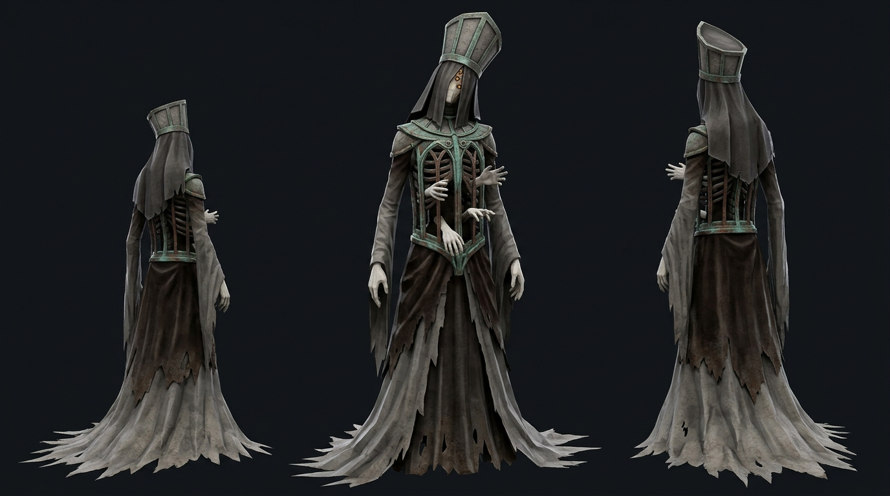

| Campo | Definição |
| --- | --- |
| **Cenário(s)** | Catacumbas (comum/elite) / Cidade Abandonada (evento raro) |
| **Tipo sugerido** | Comum ou Elite (nível base 3–5) |
| **Medo central (1 frase)** | *Uma viúva silenciosa cujo peito é uma gaiola cheia de braços mortos buscando o seu rosto.* |
| **Palavras-chave de silhueta** | Vestido fúnebre esguio de base larga em farrapos, mitra alta com véu rígido, rosto em fenda com olhos verticais empilhados, gaiola de bronze no lugar do abdômen com múltiplas mãos saindo por entre as barras. |

- **Background / Lore:** Nas criptas sob a cidade, famílias nobres recusavam-se a queimar os restos de seus parentes contaminados e pagavam ourives para trancá-los em relicários portáteis de bronze oxidado. Quando a Febre penetrou as tumbas seladas, os ossos dentro dos relicários recusaram o repouso e tomaram o corpo da guardiã que carregava o cofre atado ao peito. O crânio quebrou-se de lado sob o véu rígido, e o relicário tornou-se sua própria caixa torácica — agora habitada pelas mãos de toda uma linhagem faminta por toque humano.
- **Proposta de Mecânica (GDD §7):**
  - *Golpe de Moeda:* **Abraço do Relicário** (*Cruel*). Em **Cara**, dano reduzido ao afastar as mãos; em **Coroa**, dano +100% e aplica **Lentidão** + **Fraqueza** (as mãos agarram os braços da Bibiana).
  - *Reação:* se a Bibiana causar **Crítico** ou dano mágico alto, a gaiola se abre e ela responde com **Coro de Dedos** (golpe rápido que ignora parte da esquiva).
  - *Contra-jogo:* Defender no turno da moeda impede a captura; armas pesadas ou dano sagrado quebram o ritmo antes que acumule debuffs.

#### Especificação IA-Friendly para Reconstrução no Blender

```yaml
enemy_id: reliquary_lady
blender_conventions:
  facing: "-Y"
  up: "+Z"
  ground_z: 0.0
  origin: [0.0, 0.0, 0.0]
  target_height_m: 2.25
  triangle_budget: "2400-3100 tris"
  shading: "flat / sharp-edged low-poly"
proportions:
  head_to_body_ratio: "1 : 8.5 (elongated aristocratic silhouette)"
  headdress_height_m: 0.42
parts:
  - name: ragged_funeral_train
    coords_m: [0.0, 0.06, 0.0..0.92]
    technique: "12-sided flared skirt mesh extending slightly behind (+Y 0.45m); bottom border sculpted into uneven jagged tears; layered shorter dark-brown velvet overskirt panel on top"
  - name: reliquary_rib_cage_torso
    coords_m: [0.0, -0.02, 0.92..1.52]
    technique: "hollow interior dark void cylinder + outer octagonal bronze frame ring (top/bottom) connected by 8 curved iron/bronze vertical bars (Curve with Bevel or extruded quads) and flared shoulder pauldrons"
  - name: grasping_porcelain_hands
    coords_m: [±0.14, -0.08..-0.30, 1.02..1.42]
    technique: "4 to 5 thin forearms built via Skin modifier anchored deep inside the dark torso void, extending forward out between cage bars with simplified 3-finger + thumb low-poly splayed hands"
  - name: primary_outer_arms
    coords_m: [±0.26, 0.0, 0.72..1.48]
    technique: "hanging long sleeves (flared tapered tubes) + slender pale hands dropping to upper thigh"
  - name: tilted_head_and_miter_veil
    coords_m: [0.02, -0.04, 1.54..2.24]
    technique: "head mesh rotated 20-35 deg sideways; tall rigid faceted miter crown (extruded trapezoid prism) + heavy draped veil planes parted in front by a narrow vertical dark gap showing 3 stacked amber glowing pinprick eyes"
materials_pbr:
  - name: mat_shroud_ash
    hex: "#525250"
    roughness: 0.94
  - name: mat_funeral_velvet
    hex: "#2B211E"
    roughness: 0.96
  - name: mat_verdigris_bronze
    hex: "#4B6156"
    roughness: 0.55
    metallic: 0.70
  - name: mat_porcelain_bone
    hex: "#CFC6B4"
    roughness: 0.65
  - name: mat_amber_eyes
    hex: "#E89B2D"
    emission_strength: 5.0
animation_pivots:
  waist_sway: [0.0, 0.0, 0.92]
  head_snap_tilt: [0.0, -0.02, 1.56]
  cage_hands_root: [0.0, 0.0, 1.20]
legibility_480x270: "Tall triangular dress base + tall crown + the cluster of pale hands protruding from the dark bronze chest window read immediately at small scale."
```

---

### 4.4 Inimigo 3 — O Peregrino da Roda

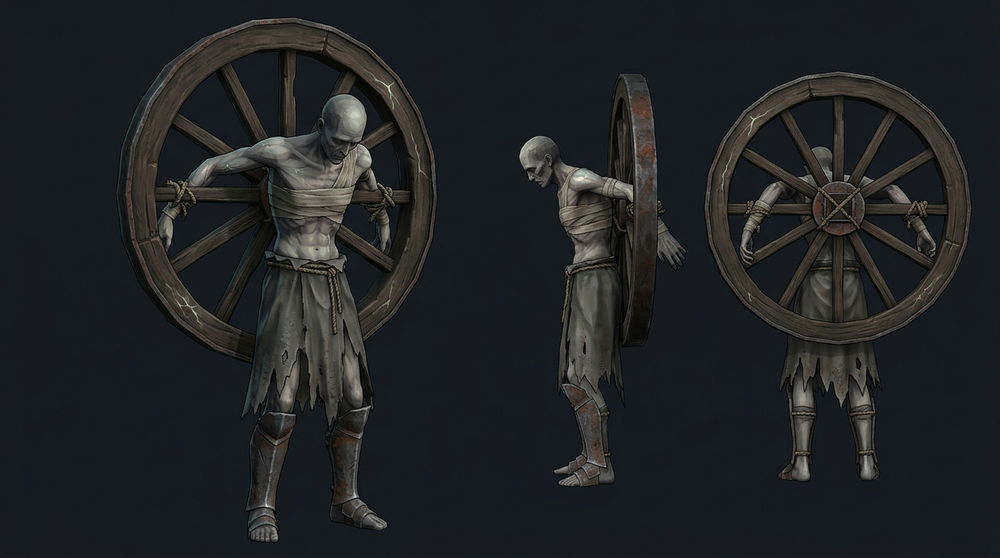

| Campo | Definição |
| --- | --- |
| **Cenário(s)** | Cidade Abandonada (comum) / Cidadela (comum/elite) |
| **Tipo sugerido** | Comum resistente (nível base 2) |
| **Medo central (1 frase)** | *Um condenado que sobreviveu à roda de suplício e agora carrega o próprio instrumento de execução para esmagar quem encontra.* |
| **Palavras-chave de silhueta** | Círculo gigante da roda atrás das costas como auréola sombria, braços torcidos para trás amarrados aos raios, corpo magro enfaixado curvado para frente, grevas de ferro pesadas. |

- **Background / Lore:** Na Praça das Sentenças, os infectados que recusavam o isolamento eram quebrados sobre rodas de carroça erguidas em postes para servir de aviso. Quando o sino da cidade parou de ser tocado pelos vivos, os corpos não morreram por completo: a Febre soldou os ossos quebrados em ângulos impossíveis. Um desses penitentes arrancou o eixo da estaca com as próprias costas e passou a marchar pelos becos inclinados, dobrado sob o aro de madeira podre e ferro que lhe rasga os ombros a cada passo.
- **Proposta de Mecânica (GDD §7):**
  - *Golpe de Moeda:* **Esmagar da Roda** (*Heavy*). Em **Cara**, golpe direto normal; em **Coroa**, ele gira e arremessa o peso da roda: dano +50% e aplica **Lentidão** ou **Atordoamento** leve (ou **Fraqueza** se mantiver os efeitos atuais).
  - *Reação:* quando cai abaixo de 45% de HP, as cordas estalam e ele ganha **Carga extra** / usa **Avanço Cego** (golpe forte avisado).
  - *Contra-jogo:* é lento no começo e tem armadura nas pernas (DEF média), mas fraco contra Fogo (madeira podre da roda).

#### Especificação IA-Friendly para Reconstrução no Blender

```yaml
enemy_id: wheel_pilgrim
blender_conventions:
  facing: "-Y"
  up: "+Z"
  ground_z: 0.0
  origin: [0.0, 0.0, 0.0]
  target_height_m: 2.05
  triangle_budget: "2000-2700 tris"
  shading: "flat / sharp-edged low-poly"
proportions:
  wheel_diameter_m: 1.55
  wheel_center_z: 1.32
  body_pitch_forward_deg: 18
parts:
  - name: execution_wheel
    coords_m: [0.0, 0.34, 1.32]
    dims_m: [1.55, 0.16, 1.55]
    technique: "16-segment polygonal ring (extruded hollow cylinder) for wooden felloe + outer beveled iron rim ring with small rivet cubes + central wooden/iron hub + 8 tapered square wooden spokes + slight vertex noise/cracks along rim edges"
  - name: gaunt_penitent_body
    coords_m: [0.0, -0.04, 0.85..1.52]
    technique: "sculpted/bmesh gaunt ribcage and sunken chest leaning forward at 18 deg; diagonal plane strips wrapped as tight chest bandages; sunken-cheek bald head pitched downward"
  - name: backward_bound_arms
    coords_m: [±0.22, -0.02, 1.42] -> [±0.48, 0.30, 1.12]
    technique: "Skin modifier arms swept backward and outward to touch horizontal spokes of the wheel; twisted Curve rope coils binding wrists directly to spokes"
  - name: ragged_kilt_and_greaves
    coords_m: [±0.16, 0.0, 0.0..0.85]
    technique: "jagged cloth loin skirt held by braided rope belt; thick beveled plate iron shin greaves over skinny ankles and bare dirt-stained feet"
materials_pbr:
  - name: mat_splintered_oak
    hex: "#42372C"
    roughness: 0.92
  - name: mat_rusted_wheel_iron
    hex: "#4F423B"
    roughness: 0.62
    metallic: 0.78
  - name: mat_corpse_skin
    hex: "#8A8479"
    roughness: 0.84
  - name: mat_linen_bandage
    hex: "#A89E89"
    roughness: 0.94
  - name: mat_fever_crack_glow
    hex: "#C9BA7B"
    emission_strength: 2.2
animation_pivots:
  pelvis_tilt: [0.0, 0.0, 0.86]
  wheel_hub: [0.0, 0.34, 1.32]
legibility_480x270: "The giant circular wheel framing the hunched silhouette behind his shoulders is readable from across the map in 270p."
```

---

### 4.5 Inimigo 4 — O Médico da Cera

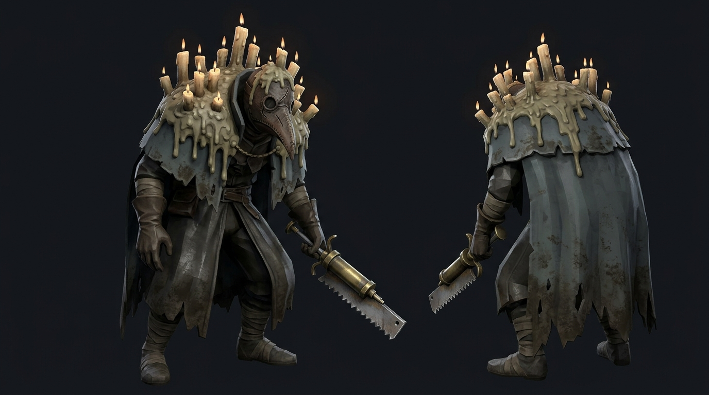

| Campo | Definição |
| --- | --- |
| **Cenário(s)** | Cidade Abandonada (evento/elite) / Catacumbas (comum) |
| **Tipo sugerido** | Comum ou Elite de suporte/veneno (nível base 2–4) |
| **Medo central (1 frase)** | *Um médico da peste que derreteu em sebo quente para não sentir a própria febre e agora vem suturar a sua.* |
| **Palavras-chave de silhueta** | Corcunda massiva coberta por cascata de cera derretida, 12+ velas acesas brotando dos ombros como coroa flamejante, máscara de bico rachada, seringa-serra enorme de latão na mão esquerda. |

- **Background / Lore:** Quando os boticários descobriram que o cheiro da Febre enlouquecia quem o inalava por dias seguidos, passaram a selar o couro de seus casacos e as frestas de suas máscaras com cera de sebo de vela benzida. No desespero do cerco, o sebo quente foi aplicado sobre a própria pele inflamada, e pavios foram fincados nos ombros para afastar o frio úmido das galerias. As camadas acumularam-se durante anos até fundir capuz, máscara e carne numa carapaça gordurosa de velas que goteja sem jamais se apagar.
- **Proposta de Mecânica (GDD §7):**
  - *Golpe de Moeda:* **Sutura de Sebo Quente** (*Cruel/Heavy*). Em **Cara**, corte superficial normal; em **Coroa**, dano +50% e aplica **Veneno** (óleo/sebo tóxico por 3 turnos).
  - *Golpe de Debuff / Cura:* **Sangria Suja** (aplica Fraqueza 60%) ou **Derreter Sebo** (regenera 12% do HP).
  - *Reação:* se sofrer dano de **Fogo**, a cera derrete violentamente e no turno seguinte ele reage com **Respingo Fervente** (ataque forte avisado).
  - *Contra-jogo:* foco em bursts para não deixá-lo curar; usar Defender quando o aviso indicar Sutura de Sebo.

#### Especificação IA-Friendly para Reconstrução no Blender

```yaml
enemy_id: wax_physician
blender_conventions:
  facing: "-Y"
  up: "+Z"
  ground_z: 0.0
  origin: [0.0, 0.0, 0.0]
  target_height_m: 1.90
  triangle_budget: "2300-3100 tris"
  shading: "flat / sharp-edged low-poly"
proportions:
  hunchback_hump_z: "1.35..1.72"
  head_forward_y: -0.26
parts:
  - name: hunched_trench_coat_and_cloak
    coords_m: [0.0, 0.05, 0.15..1.58]
    technique: "broad hunched shoulder cape (flared jagged hem) + split knee-length apothecary coat + wrapped leggings and heavy leather boots"
  - name: melted_wax_mantle
    coords_m: [0.0, 0.02, 1.15..1.68]
    technique: "draped organic blob/metaball converted to mesh and Decimated to ~450 tris covering shoulders, upper back, and top of mask; extruded vertical stalactite drip fingers hanging along chest and shoulder rims"
  - name: shoulder_candles
    coords_m: [±0.12..0.42, -0.05..0.18, 1.55..1.98]
    technique: "11 to 14 tilted 6-sided cylinders of varying lengths embedded into wax mantle; tiny teardrop billboard/cone meshes at tips for amber candle flames"
  - name: cracked_beak_mask
    coords_m: [0.0, -0.26, 1.38..1.64]
    technique: "faceted hood + cone-extruded downward curved beak + two inset brass goggle rings with dark recessed lenses + wax blob dripping over forehead"
  - name: brass_saw_syringe
    coords_m: [-0.34, -0.45, 0.45..0.95]
    technique: "long brass cylinder chamber + T-plunger handle + thick needle nozzle + serrated steel bone-saw blade bolted underneath (6 triangular teeth)"
materials_pbr:
  - name: mat_slate_cloak
    hex: "#46525C"
    roughness: 0.90
  - name: mat_oiled_leather
    hex: "#332E2B"
    roughness: 0.72
  - name: mat_rotting_wax
    hex: "#B5A578"
    roughness: 0.42
  - name: mat_tarnished_brass
    hex: "#8A7240"
    roughness: 0.40
    metallic: 0.85
  - name: mat_candle_flame
    hex: "#FFA938"
    emission_strength: 6.0
animation_pivots:
  torso_hunch: [0.0, 0.0, 0.95]
  weapon_wrist: [-0.30, -0.28, 0.82]
legibility_480x270: "The halo of lit flickering candle points around the humped shoulders + elongated beak profile + oversized brass saw-syringe read instantaneously."
```

---

### 4.6 Inimigo 5 — A Lavadeira do Brejo

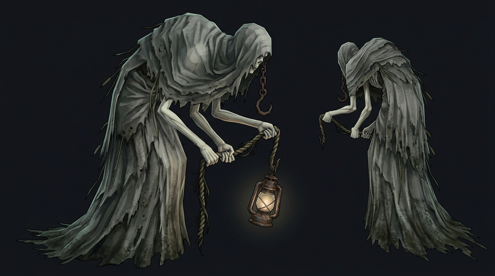

| Campo | Definição |
| --- | --- |
| **Cenário(s)** | Brejo Doente (comum) / Cidade Abandonada - canais alagados (raro) |
| **Tipo sugerido** | Comum de desgaste (nível base 1–3 no Brejo) |
| **Medo central (1 frase)** | *Uma figura dobrada ao meio na névoa do pântano que torce cabelos afogados — e usa um lampião enferrujado como isca.* |
| **Palavras-chave de silhueta** | Corpo altíssimo dobrado em ângulo de 90° na cintura, mortalha cinza encharcada arrastando no chão, quatro braços brancos finos saindo de baixo do manto torcendo corda, gancho + lampião pendurados na frente do rosto/peito. |

- **Background / Lore:** Nas margens lamacentas do Brejo Doente, camponesas tentavam lavar as mortalhas dos doentes na água estagnada acreditando que a correnteza levaria a Febre embora. Quando o pântano secou em lodo negro, quem ali se ajoelhou por tempo demais não conseguiu mais endireitar a espinha. Hoje o vulto caminha quase em ângulo reto sobre saias podres de juncos, com membros extras nascidos sob o pano úmido para torcer uma corda infindável de raízes e fios, balançando uma lanterna enferrujada para atrair perdidos na neblina.
- **Proposta de Mecânica (GDD §7):**
  - *Golpe de Moeda:* **Torcer a Mortalha** (*Heavy*). Em **Cara**, chicotada normal com a corda úmida; em **Coroa**, dano +50% e aplica **Veneno** de água podre ou **Lentidão** (linho encharcado prende os pés).
  - *Reação:* quando fica abaixo de 50% de HP, apaga/balança o lampião e usa **Isca do Afogado** (golpe de debuff que tenta aplicar **Cegueira** ou **Fraqueza**).
  - *Contra-jogo:* fraca a **Fogo** (mortalha e juncos secos nas pontas); tem ESQ moderada pela postura baixa e sinuosa.

#### Especificação IA-Friendly para Reconstrução no Blender

```yaml
enemy_id: bog_washerwoman
blender_conventions:
  facing: "-Y"
  up: "+Z"
  ground_z: 0.0
  origin: [0.0, 0.0, 0.0]
  target_height_m: 1.95
  triangle_budget: "2200-3000 tris"
  shading: "flat / sharp-edged low-poly"
proportions:
  bent_torso_angle_deg: 85
  shroud_footprint_y: "-0.35..+0.65 (deep trailing cloak)"
parts:
  - name: drowned_shroud_and_train
    coords_m: [0.0, 0.10, 0.0..1.85]
    technique: "tall lower robe cone flared at ground + sweeping upper hood/cape arched forward over waist bend; jagged ragged strip cuts along hem and trailing swamp reeds (thin bent quads) sticking out of folds"
  - name: bowed_skull_under_veil
    coords_m: [0.0, -0.36, 1.38..1.65]
    technique: "gaunt pale skull barely peeking inside deep cloth hood shadow"
  - name: four_wringing_arms
    coords_m: [±0.16, -0.18, 1.15] -> [±0.12, -0.45, 0.72]
    technique: "4 thin skeletal arms (2 upper pair, 2 lower pair emerging from dark cloak slit) built with Skin modifier; elbows angled sharply outward, hands gripping a shared point in front"
  - name: twisted_hair_rope
    coords_m: [-0.20..+0.25, -0.48, 0.25..0.85]
    technique: "2 intertwined Curve paths with Bevel + frayed loose ends hanging toward ground"
  - name: neck_hook_and_lantern
    coords_m: [0.0, -0.48, 0.50..1.42]
    technique: "iron chain + S-hook dangling vertically from neck/hood fold down to an octagonal rusted cage lantern holding an amber glowing core"
materials_pbr:
  - name: mat_wet_shroud
    hex: "#585E5A"
    roughness: 0.88
  - name: mat_mire_stain
    hex: "#32352C"
    roughness: 0.95
  - name: mat_drowned_flesh
    hex: "#BAB5AA"
    roughness: 0.75
  - name: mat_rusted_hook
    hex: "#4B3A31"
    roughness: 0.65
    metallic: 0.75
  - name: mat_lantern_amber
    hex: "#E6A945"
    emission_strength: 5.5
animation_pivots:
  waist_arch: [0.0, 0.15, 1.10]
  lantern_swing: [0.0, -0.44, 1.35]
  arms_wring_pivot: [0.0, -0.30, 1.05]
legibility_480x270: "The extreme 90-degree bent hump, dangling warm lantern under the chin, and multiple pale arms below form a completely unique non-human silhouette."
```

---

### 4.7 Inimigo 6 — O Coro Sem Lábios

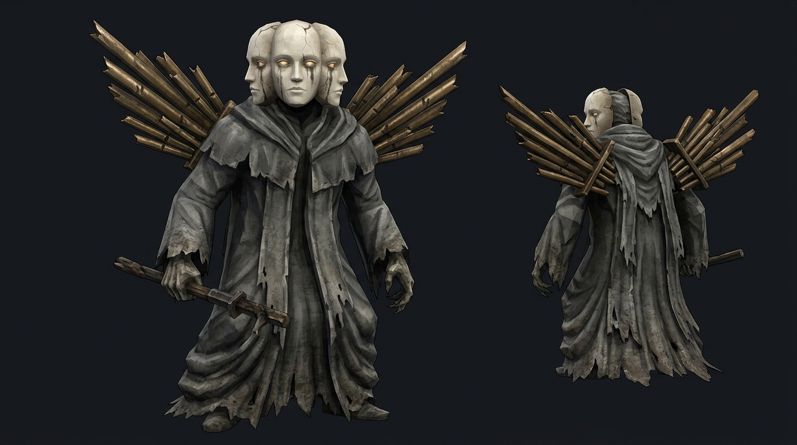

| Campo | Definição |
| --- | --- |
| **Cenário(s)** | Catedral dos Sinos (comum/elite) / Cidade Abandonada (elite raro) |
| **Tipo sugerido** | Elite ou Comum avançado de som/maldição (nível base 4–6) |
| **Medo central (1 frase)** | *Três rostos de porcelana sem boca que ainda cantam pelas frestas metálicas dos pulmões.* |
| **Palavras-chave de silhueta** | Hábito clerical esguio e alto, asas simétricas de tubos quebrados de órgão de bronze nos ombros, cabeça gigante tricéfala formada por três máscaras brancas sem boca chorando fuligem. |

- **Background / Lore:** Na Catedral dos Sinos, quando a tosse da Febre silenciou o coro humano, o alto clero tentou substituir as vozes por ressonadores de bronze encaixados diretamente sobre as clavículas dos noviços mortos. Máscaras de porcelana sem lábios foram seladas sobre os rostos para impedir que a doença escapasse pela respiração. Mesmo sem boca, a corrente de ar que atravessa seus tubos enferrujados emite um acorde grave e dissonante que embrulha o estômago a dezenas de metros antes de o jogador enxergar a figura.
- **Proposta de Mecânica (GDD §7):**
  - *Golpe de Moeda:* **Acorde Sem Boca** (*Cruel*). Em **Cara**, ressonância leve; em **Coroa**, dano +100% e aplica **Maldição** (dano recebido +20% por 3 turnos).
  - *Golpe de Debuff:* **Dissonância** (aplica **Fraqueza** ou **Cegueira** com 65% de chance).
  - *Reação:* se a Bibiana tiver algum **buff ativo** (Fúria/Muralha), as três máscaras giram e respondem com um acorde de debuff avisado.
  - *Contra-jogo:* baixa defesa física (hábitos de pano), mas alta resistência mágica (`RES`); atordoar ou quebrar com golpe pesado interrompe o canto.

#### Especificação IA-Friendly para Reconstrução no Blender

```yaml
enemy_id: lipless_choir
blender_conventions:
  facing: "-Y"
  up: "+Z"
  ground_z: 0.0
  origin: [0.0, 0.0, 0.0]
  target_height_m: 2.35
  triangle_budget: "2300-3000 tris"
  shading: "flat / sharp-edged low-poly"
proportions:
  head_scale: "1.45x normal human head (oversized uncanny triple-mask cluster)"
  organ_wing_span_m: 1.75
parts:
  - name: fused_liturgical_robe
    coords_m: [0.0, 0.0, 0.0..1.72]
    technique: "tall layered clerical mantle (draped front stole + jagged tattered hem + wide drooping sleeves with crooked clawed hands emerging at sides; omit random wooden rod from concept draft)"
  - name: broken_organ_pipe_wings
    coords_m: [±0.26..±0.88, 0.14, 1.38..2.18]
    technique: "10 to 12 octagonal hollow bronze cylinders per side arranged in fan angle (+35 to +60 deg), stepped lengths with angled bevel cuts on top mouths and wooden rack crossbars bolted into shoulder mantle"
  - name: triple_mouthless_masks
    coords_m: [0.0, -0.08, 1.76..2.28]
    technique: "central dome head wrapped by 3 smooth-faceted oval porcelain masks facing 0 deg, +65 deg, and -65 deg; NO mouth or lip seam sculpted; narrow recessed eye sockets weeping thin black soot tear planes downward; glowing pale-gold eyes"
materials_pbr:
  - name: mat_charcoal_habit
    hex: "#2D3036"
    roughness: 0.94
  - name: mat_tarnished_organ_bronze
    hex: "#78623D"
    roughness: 0.45
    metallic: 0.84
  - name: mat_porcelain_mask
    hex: "#D6CFC0"
    roughness: 0.38
  - name: mat_soot_tears
    hex: "#121215"
    roughness: 0.95
  - name: mat_gold_eye_glow
    hex: "#F0BA54"
    emission_strength: 4.5
animation_pivots:
  spine_sway: [0.0, 0.0, 1.0]
  triple_head_spin: [0.0, -0.05, 1.78]
  pipe_wings_l_r: [±0.24, 0.14, 1.50]
legibility_480x270: "The V-shaped fan of organ pipes behind the pale triple-white head reads cleanly against dark stone walls."
```

---

### 4.8 Inimigo 7 — O Cavaleiro Calcificado

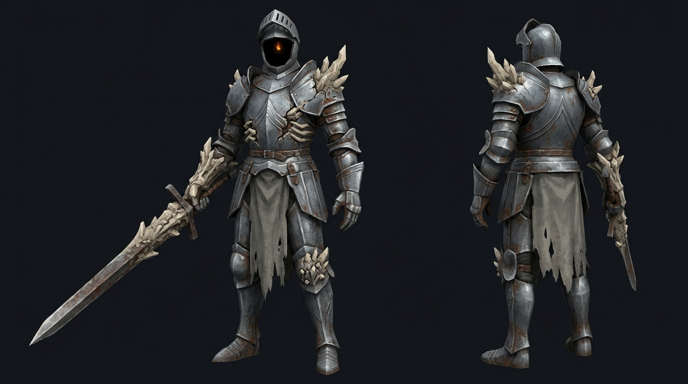

| Campo | Definição |
| --- | --- |
| **Cenário(s)** | Cidadela (elite/comum pesado) / Catacumbas profundas (elite raro) |
| **Tipo sugerido** | Elite pesado ou Mini-Boss de cenário avançado (nível base 5–8) |
| **Medo central (1 frase)** | *Um guarda real cujo esqueleto cresceu para fora da armadura até soldar espada, aço e osso num cadáver que não cai.* |
| **Palavras-chave de silhueta** | Armadura gótica estriada e enferrujada partida por espinhos/corais calcificados brancos nos ombros, peito e joelho, braço direito fundido ao espadão, elmo aberto com vazio negro e uma brasa solitária no fundo. |

- **Background / Lore:** Nos andares altos da Cidadela, a Febre atinge sua forma terminal: a calcificação acelerada. Os cavaleiros encarregados de impedir que alguém alcançasse a câmara do rei permaneceram de guarda durante anos em corredores fechados. Seus próprios ossos proliferaram como coral pálido pelas juntas das armaduras, arrebentando ombreiras e couraças, até soldar a manopla direita ao cabo do espadão. Nada resta sob o elmo aberto além de um oco enegrecido onde arde uma única brasa de consciência rígida.
- **Proposta de Mecânica (GDD §7):**
  - *Golpe de Moeda:* **Corte Calcificado** (*Cruel*). Em **Cara**, bloqueável com dano normal; em **Coroa**, dano +100% e aplica **Fraqueza** (impacto massivo quebra a postura).
  - *Reação:* quando recebe ataques repetidos sem Defender, ou quando a Bibiana está com HP cheio/buffs, entra em postura de **Lâmina Soldada** (próximo golpe forte ignora parte da DEF).
  - *Contra-jogo:* defesa física altíssima (`DEF`), muito lento (`VEL` baixa); vulnerável a **Dano Mágico / Sagrado / Críticos** e fácil de antecipar na linha do tempo.

#### Especificação IA-Friendly para Reconstrução no Blender

```yaml
enemy_id: calcified_knight
blender_conventions:
  facing: "-Y"
  up: "+Z"
  ground_z: 0.0
  origin: [0.0, 0.0, 0.0]
  target_height_m: 2.20
  triangle_budget: "2500-3200 tris"
  shading: "flat / sharp-edged PS1-PS2 low-poly"
proportions:
  shoulder_width_m: 0.88
  greatsword_length_m: 1.55
parts:
  - name: fluted_gothic_plate
    coords_m: [0.0, 0.0, 0.0..1.72]
    technique: "modular beveled plate armor segments (cuirass with angled chest ridge, tassets, fluted pauldrons, sabatons and articulated gauntlets) + tattered ash tabard hanging between legs"
  - name: bone_coral_eruptions
    coords_m: ["+0.36 shoulder", "-0.34 shoulder", "chest cracks", "left knee", "right forearm"]
    technique: "clusters of 4 to 7 sharp tapered organic bone spikes (extruded irregular 5-sided cones with slight curve) bursting outward through cracked armor bevel openings"
  - name: fused_greatsword_arm
    coords_m: [-0.42, -0.15..-1.25, 0.18..1.05]
    technique: "right gauntlet plates merged directly into crossguard + broad 2-edged greatsword blade encrusted with asymmetric calcified bone ribs along the spine and ricasso (no separate grip fingers)"
  - name: hollow_armet_helm
    coords_m: [0.0, -0.04, 1.72..2.12]
    technique: "slotted medieval armet with raised slotted visor framing a pitch-black deep concave cavity (mat_pitch_void) containing one tiny centered glowing ember sphere"
materials_pbr:
  - name: mat_cold_tarnished_steel
    hex: "#4B525C"
    roughness: 0.42
    metallic: 0.86
  - name: mat_armor_rust
    hex: "#593E2F"
    roughness: 0.78
    metallic: 0.45
  - name: mat_calcified_bone
    hex: "#D6CEBA"
    roughness: 0.75
  - name: mat_tattered_tabard
    hex: "#6B6861"
    roughness: 0.94
  - name: mat_pitch_void
    hex: "#020203"
    roughness: 1.0
  - name: mat_visor_ember
    hex: "#F2791D"
    emission_strength: 6.5
animation_pivots:
  waist: [0.0, 0.0, 1.02]
  right_shoulder_swing: [-0.36, 0.0, 1.56]
legibility_480x270: "Jagged white bone horns erupting off dark steel shoulders + huge fused sword + pitch-black helmet holding a single orange dot."
```

---

### 4.9 Inimigo 8 — O Rastejador da Vala

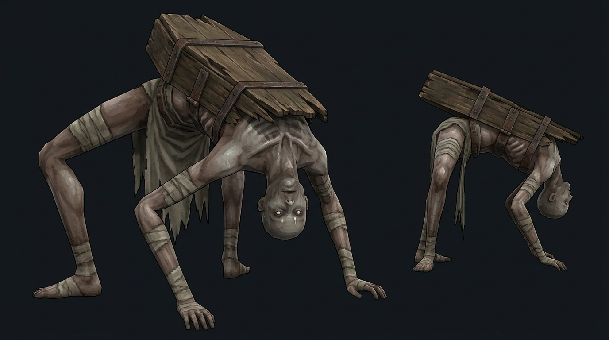

| Campo | Definição |
| --- | --- |
| **Cenário(s)** | Catacumbas (comum/emboscada) / Brejo Doente (comum) |
| **Tipo sugerido** | Comum ágil / especialista em emboscada (nível base 1–3) |
| **Medo central (1 frase)** | *Algo com membros demais que carrega um caixão amarrado às costas — e te olha de cabeça para baixo por entre os joelhos.* |
| **Palavras-chave de silhueta** | Corpo arqueado em ponte invertida sobre quatro membros longos enfaixados em ângulo aracnídeo, tampa de caixão podre presa por cintas de ferro no dorso arqueado, cabeça pálida pendurada de cabeça para baixo entre os membros dianteiros. |

- **Background / Lore:** Nas valas comuns onde cadáveres eram lançados antes de exalar o último suspiro, alguns corpos contorceram-se de tal modo sob o peso dos caixões fechados às pressas que as articulações viraram ao contrário. O que emerge das fossas anda em ponte invertida, usando a própria tampa podre de madeira como carapaça contra pedras e lâminas, espreitando o chão de ponta-cabeça pelas frestas entre os braços antes de dar o bote.
- **Proposta de Mecânica (GDD §7):**
  - *Golpe de Moeda:* **Bote da Cova** (*Heavy*). Em **Cara**, arranhão comum; em **Coroa**, dano +50% e aplica **Cegueira** ou **Veneno** (lama de vala e unhas podres).
  - *Reação:* se a Bibiana tentar atacar logo após o bote ou ficar abaixo de 60% de HP, fecha a carapaça ou avança com **Mordida Invertida** (golpe rápido).
  - *Contra-jogo:* esquiva alta (`ESQ`) e velocidade alta (`VEL`), perfeito para nós de **Emboscada / "?"**; pouca vida máxima e vulnerável a golpes com alta precisão ou atordoamento.

#### Especificação IA-Friendly para Reconstrução no Blender

```yaml
enemy_id: trench_crawler
blender_conventions:
  facing: "-Y"
  up: "+Z"
  ground_z: 0.0
  origin: [0.0, 0.0, 0.0]
  target_height_m: 1.45
  triangle_budget: "1900-2600 tris"
  shading: "flat / sharp-edged low-poly"
proportions:
  stance: "quadruped inverted-arch span ~1.75m wide/deep, torso arch apex at Z=1.12"
parts:
  - name: arched_emaciated_torso
    coords_m: [0.0, 0.0, 0.92..1.18]
    technique: "curved ribcage/spine cylinder arched smoothly from +Y pelvis to -Y chest (Skin modifier or curved extruded loops), visible rib ridges underneath"
  - name: four_spider_limbs
    coords_m: ["front hands at [±0.48, -0.62, 0.0]", "back feet at [±0.42, +0.68, 0.0]"]
    technique: "4 exaggeratedly long limbs with sharp knees/elbows peaking at Z=1.05..1.18 before plunging straight down to hands/feet; spiral bandage wrap strips around forearms and shins"
  - name: coffin_lid_carapace
    coords_m: [0.0, 0.02, 1.15..1.48]
    dims_m: [0.68, 1.28, 0.24]
    technique: "tapered hexagonal coffin plank box strapped atop the arched back/belly, split planks with jagged splintered ends + 2 heavy iron strap bands with hinge bolts wrapping around the ribcage"
  - name: upside_down_hanging_head
    coords_m: [0.0, -0.34, 0.58..0.88]
    technique: "curved neck dropping straight down under front chest; gaunt pale skull/head rotated 180 deg upside-down (chin upward, forehead downward) with two small bright pale-white eyes staring forward toward -Y"
materials_pbr:
  - name: mat_rotted_coffin_wood
    hex: "#45392C"
    roughness: 0.94
  - name: mat_rusted_straps
    hex: "#3E3430"
    roughness: 0.68
    metallic: 0.72
  - name: mat_grave_rags
    hex: "#6B675D"
    roughness: 0.95
  - name: mat_pale_damp_flesh
    hex: "#78726B"
    roughness: 0.80
  - name: mat_pale_pinprick_eyes
    hex: "#EDEBD8"
    emission_strength: 4.5
animation_pivots:
  arch_center: [0.0, 0.0, 1.05]
  head_pendulum: [0.0, -0.28, 0.92]
legibility_480x270: "The huge wooden coffin slab floating atop 4 spidery bent limbs + the eerie upside-down pale face suspended underneath is instantly unsettling."
```

---

### 4.10 Por que o pipeline Blender atual sai "quadradão" — e como evoluir (`tools/blender/kit.py` + Rota Híbrida)

Olhando `tools/blender/kit.py` e `tools/blender/make_horrors.py` (`TASK-047-stitched_horror.png`, `TASK-047-bell_warden.png`):
- **Diagnóstico técnico:** `kit.py` usa apenas primitivos puros sem modificação (`primitive_cube_add`, `primitive_cylinder_add`, `primitive_ico_sphere_add` com 1 subdivisão) e materiais de cor totalmente chapada (`Base Color` uniforme sem textura nem variação por vértice). Por isso, quando vão para o Godot, mesmo boas ideias como o *Costurado* ou *Carcereiro do Sino* parecem montagens rígidas de blocos.
- **4 helpers simples para adicionar ao `kit.py` (sem perder baixo polígono):**
  1. `skin_limb(points, radii, mat)`: gera membros orgânicos articulados e costelas curvas com `Skin` + `Decimate` (~80 tris por membro) em vez de cilindros retos soltos.
  2. `draped_cloth(top_ring, bottom_ring, tears, mat)`: gera mantos, véus e mortalhas em `bmesh` com dobras verticais e bordas rasgadas irregulares (sem `cube` plano).
  3. `bevel_displace(obj, width, noise_amt)`: quebra quinas perfeitas de madeira, pedra e ferro com chanfro leve (`Bevel`) e desgaste (`Displace`), essencial para a silhueta PS1/Vagrant Story.
  4. `vertex_grime(obj, bottom_dark, top_tint)`: pinta um atributo de cor por vértice (`Color Attribute`) escurecendo a base próxima do chão/dobras com lama e fuligem — zero custo extra de memória de textura e elimina instantaneamente a cara de plástico chapado!
- **Rota Híbrida (GDD §18):** Para chefes, elites e os 8 novos horrores, os esboços gerados aqui com **Nano Banana** já servem como entrada direta no **TRELLIS.2** (licença MIT) para gerar a malha base orgânica em 3D, passando depois por `Decimate` + `vertex_grime` + ajuste de pivôs no Blender para bater o orçamento de **2.000–3.200 triângulos**.

---

## Parte 5 — Estudo de Estética Dark Fantasy "Mundo Morrendo" (Refinamento 3D)

### 5.1 Galeria de Referências de Estética Analisadas

#### A. Linhagem Square Enix / Yasumi Matsuno (*Final Fantasy Tactics*, *Vagrant Story*, *Tactics Ogre*, *Triangle Strategy*)

| *Final Fantasy Tactics* (Luz única na cripta) | *Final Fantasy Tactics* (Diorama com relevo) | *Vagrant Story* (Combate Catedral PS1) | *Vagrant Story* (Cidade Noturna) |
| :---: | :---: | :---: | :---: |
| 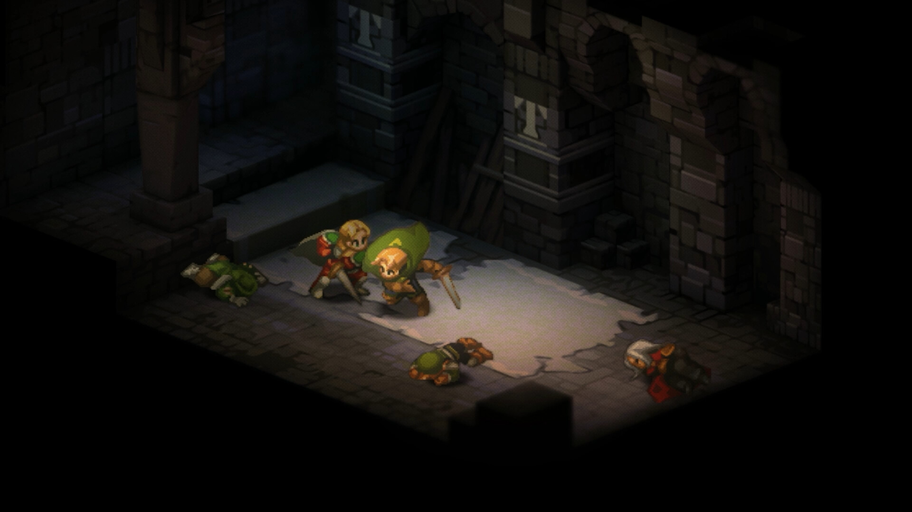 | 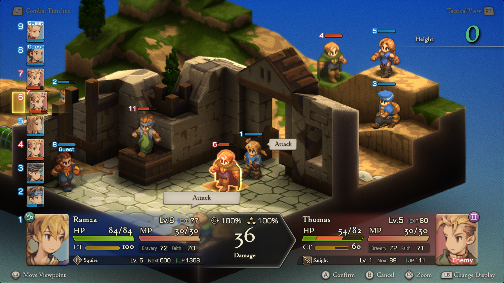 | 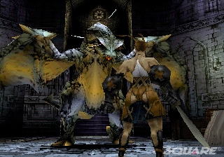 | 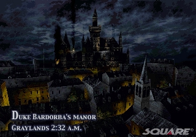 |

| *Tactics Ogre: Reborn* (Paleta medieval) | *Triangle Strategy* (HD-2D noturno) |
| :---: | :---: |
| 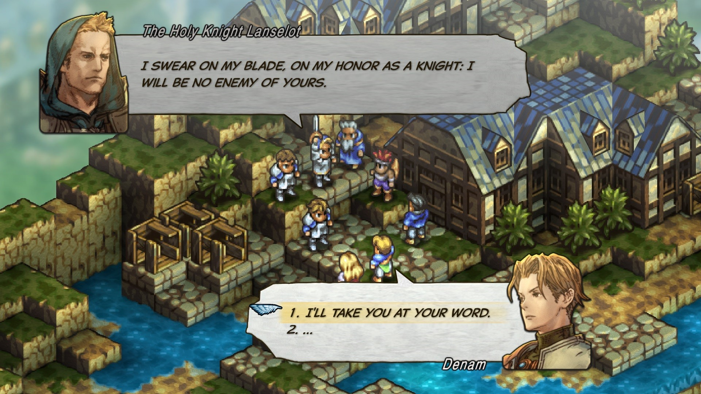 | 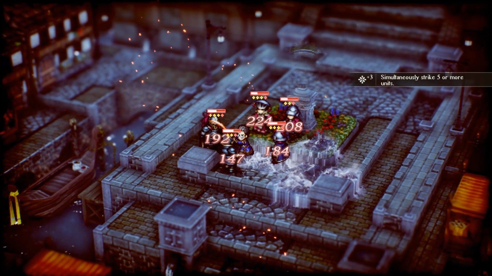 |

- **O que *FFT* e *Vagrant Story* provam:** um mundo não parece sombrio porque colocaram névoa roxa — parece sombrio porque **quase toda a cena está na sombra profunda e apenas uma fresta de luz (fogo ou fenda de luar) revela a textura suja da pedra**. Em `estetica-fft-ivalice.jpg`, os cantos da cripta simplesmente afundam em preto quase puro; em `estetica-vagrant-story-combate.jpg`, o monstro divide a catedral fria e suja com uma única sombra forte projetada no chão.
- **O que *Triangle Strategy* e *Tactics Ogre* acrescentam:** textura mineral visível nas lajes, contraste dramático entre **azul-ardósia frio nas sombras** e **âmbar/ocre quente nas tochas**, mais partículas sutis em primeiro plano com vinheta nas bordas.

#### B. Mundos Morrendo & Horror Low-Poly PS1/PS2 (*Labyrinth*, *Crow Country*, *Lunacid*, *Dread Delusion*, *Felvidek*)

| *Labyrinth of the Demon King* (Chuva & Lodo) | *Labyrinth of the Demon King* (Cripta & Terror) | *Crow Country* (Isométrico PS1 sujo) |
| :---: | :---: | :---: |
| 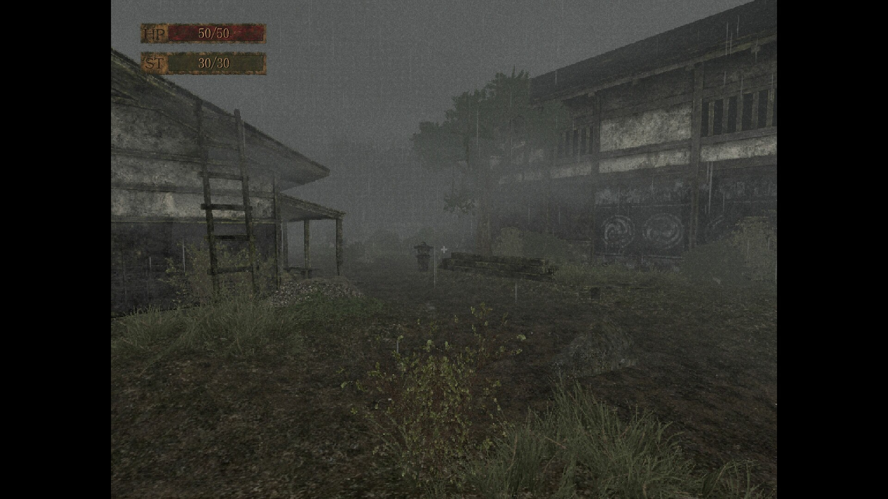 | 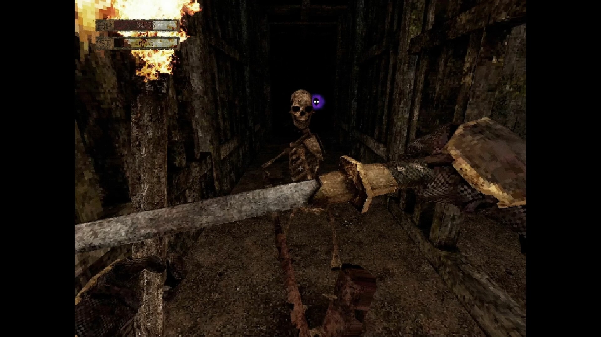 | 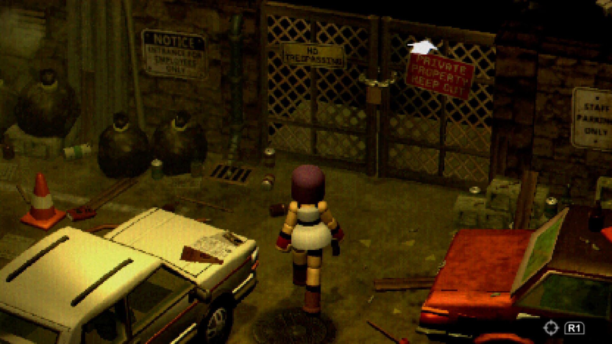 |

| *Lunacid* (Cripta PS1 granulada) | *Dread Delusion* (Mundo Morrendo) | *Felvidek* (Dithering medieval sujo) |
| :---: | :---: | :---: |
| 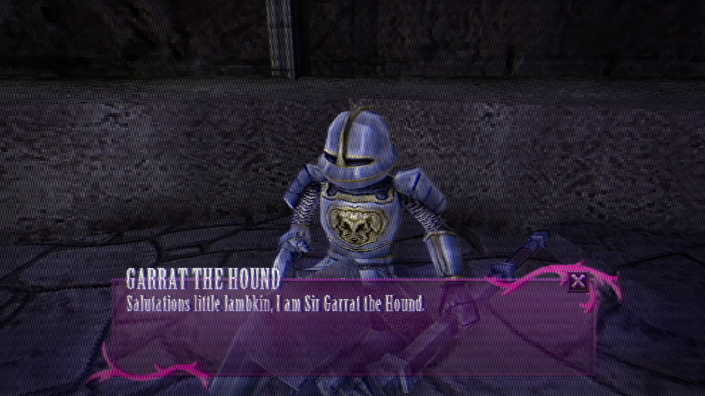 | 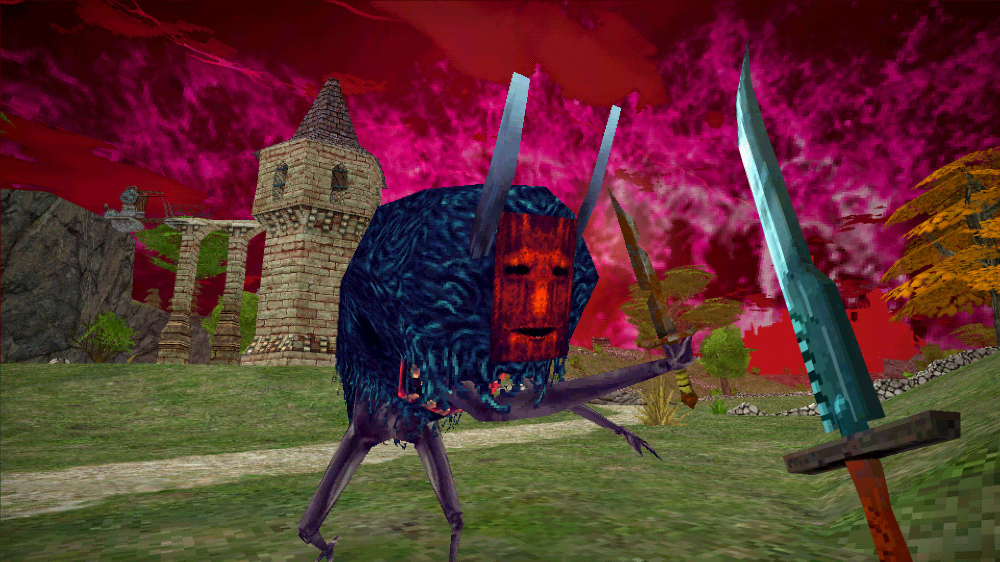 | 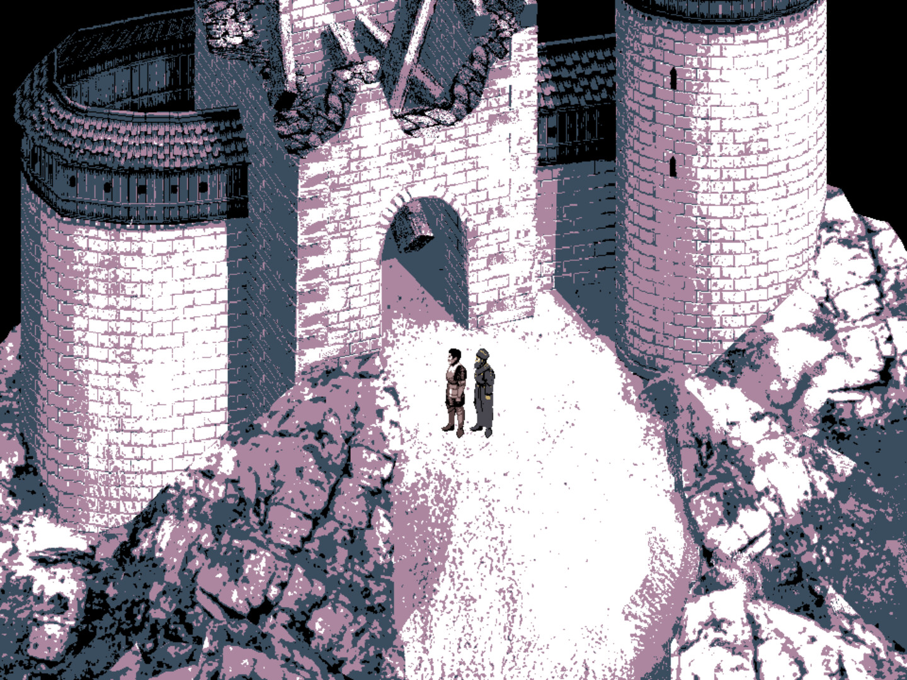 |

- **Lições diretas de `Labyrinth of the Demon King` e `Crow Country`:**
  1. **Dithering e grão de textura quebram o "liso de plástico":** a posterização pura do nosso `post_fx.gd` (`floor(c * levels + 0.5) / levels`) cria faixas planas que lembram desenho vetorial limpo; quando combinada com uma matriz Bayer 4×4 sutil antes da quantização, sombras e névoa ganham instantaneamente a aspereza orgânica do PS1.
  2. **Zero verde vibrante de pinheiro:** veja `estetica-labyrinth-demon-king-chuva.jpg` — mesmo com vegetação na chuva, o verde é musgo quase cinza-lodo afogado em neblina. Nosso mapa atual usa `pine-crooked.glb` com copa verde-azulada saturada do Kenney que destoa totalmente de um mundo em praga.
  3. **Inimigo emergindo da escuridão absoluta:** em `estetica-labyrinth-demon-king-cripta.jpg`, a luz da tocha morre a poucos metros e o fundo desaparece no preto, fazendo o inimigo parecer perigoso antes mesmo de se mexer.

---

### 5.2 Diagnóstico Técnico do Visual Atual vs Referências

Comparando nossos arquivos de cena (`combat3d_stage.gd`, `map3d_screen.gd`, `scene3d_backdrop.gd`, `post_fx.gd`) com os prints atuais:

1. **Luz Ambiente excessiva e roxa (`combat3d_stage.gd:79-80`, `map3d_screen.gd:111-112`, `scene3d_backdrop.gd:64-65`)**:
   - Hoje `ambient_light_energy` está entre **`1.0` e `1.1`** com cor `(0.26..0.3, 0.3..0.35, 0.42..0.48)` — e no `combat3d_stage` o piso é `floor-detail.glb` tingido de `(0.58, 0.56, 0.62)`. Juntos, lavam as sombras com um lilás/lavanda uniforme que mata o clima de terror.
   - Em `Combat3DStage`, a câmera é ortogonal distante (`CAM_SIZE = 5.8`, alvo `(0.2, 2.0, 0.2)`) e a luz quente é uma `OmniLight3D` central fraca em cima do piso já claro, eliminando contraste dramático.
2. **Elementos "fofos / de brinquedo" sobreviventes**:
   - **Pinheiros verdes do Kenney** (`pine-crooked.glb`, `pine-fall.glb`) aparecem no mapa (`TASK-043-mapa-equipamento.png`), no combate comum (`combat3d_stage.gd:149`), na fogueira e na Home (`scene3d_backdrop.gd:199, 267`).
   - **Proporção chibi da Bibiana (`KayKit Knight.glb`)** com cabeça enorme e espada curta: aceitável no mapa isométrico distante (como os sprites de FFT!), mas no combate próximo e contra inimigos altos e macabros, o contraste entre cabeça fofa de boneco e horror gótico precisa ser compensado por enquadramento de costas mais escuro, capacete mais sombrio e silhuetas sérias nos monstros.
   - **Mercador errado na loja** (`scene3d_backdrop.gd:208` usando `"gravedigger"`).
3. **`PostFx` (`game/presentation/fx/post_fx.gd`) subaproveitado**:
   - O `blur_amount = 1.3` nas bordas verticais sem dithering dá sensação de miniatura borrada/brinquedo.
   - O contorno usa apenas luminância dos vizinhos com `edge_strength = 0.6` e escurece para `c * 0.3` — contorno preto forte em peças coloridas acentua o visual de "cartoon/voxel fofo", enquanto em *Vagrant Story* e *Labyrinth* o contorno nasce da **sombra própria, textura e dithering**, ou contorno bem mais sutil nas bordas de profundidade.

---

### 5.3 Style Bible 2.0 — Proposta Concreta de Refinamento Estético

#### A. Paleta Revisada de "Mundo Morrendo" (Cenário 1 — Cidade Abandonada)

| Papel na Cena | Hex Proposto | RGB Linear aprox. | Onde aplicar e Regra |
| --- | :---: | :---: | :--- |
| **Abismo / Preto de Fundo** | `#07080B` | `(0.006, 0.007, 0.011)` | `background_color` e bordas da vinheta (sai o azul-lilás claro) |
| **Sombra Fria de Pedra** | `#1B2029` | `(0.013, 0.017, 0.026)` | `ambient_light_color` (com energia baixa `0.38–0.48`) |
| **Laje & Pedra Úmida** | `#4A4E54` | `(0.07, 0.08, 0.09)` | Multiplicador de cor sobre `floor-detail.glb` e muros (sai o cinza-lilás) |
| **Terra / Lama / Madeira Podre** | `#3A3128` | `(0.04, 0.03, 0.022)` | Blocos de terreno (`dirt.glb`), caixões e pontes |
| **Luar Frio Direcional** | `#7E8FA8` | `(0.21, 0.28, 0.39)` | `DirectionalLight3D` oblíqua (`energy = 0.65`, sombra ativada) |
| **Fogo / Tocha / Foco Quente** | `#D97828` | `(0.70, 0.20, 0.025)` | Única luz quente por cena (`OmniLight3D` / `SpotLight3D`) criando foco focal |
| **Febre / Podridão (sutil)** | `#8A834C` | `(0.26, 0.23, 0.07)` | Olhos doentes, mofo, vapor de esgoto |
| **Acento Único — Mecha da Bibiana** | Dinâmico (GDD §9) | — | Único elemento de cor saturada da heroína + Vermelho Perigo (`#B82824`) + Ouro Moeda (`#D9AA32`) |

#### B. Parâmetros Técnicos Propostos para Iluminação e Shader (`PostFx 2.0`)

1. **`WorldEnvironment` (Combate, Mapa e Backdrops):**
   - Baixar `ambient_light_energy` de `1.0–1.1` para **`0.40`** (Combate/Backdrops) e **`0.52`** (Mapa, para preservar leitura dos 3 caminhos).
   - Ligar **Depth Fog / Volumetric-like Exponential Fog** na distância (`fog_enabled = true`, `fog_light_color = Color(0.04, 0.045, 0.06)`, `fog_density = 0.035–0.05` no combate e fundos) para engolir os muros ao fundo em penumbra autêntica.
   - `tonemap_mode = Environment.TONE_MAPPER_ACES` (ou Filmic) com `adjustment_saturation = 0.48`, `adjustment_contrast = 1.24`, `adjustment_brightness = 0.88`.
2. **Iluminação Dramática no Palco de Combate (`Combat3DStage`):**
   - Trocar a `OmniLight3D` central fraca por **luz de palco vertical / `SpotLight3D`** sobre a arena central (como um clarão de claraboia/tocha vindo de cima em ângulo agudo), deixando as costas dos muros e os cantos mergulhados no escuro.
   - Adicionar **rim-light fria** discreta atrás do inimigo para recortar a silhueta macabra contra a cripta escura (sem iluminar a frente dele por igual).
3. **`PostFx 2.0` (`game/presentation/fx/post_fx.gd`)**:
   - Trocar a quantização dura `floor(c * levels)` por **Ordered Dithering Bayer 4×4** com `12` a `16` níveis por canal: isso produz aquele grão clássico de PlayStation 1 (*Vagrant Story* / *Labyrinth*) mantendo compatibilidade total com `Compatibility` (OpenGL ES 3.0) em celulares médios (custo: 1 matriz `const mat4` no fragment shader, zero texture lookup extra!).
   - Adicionar **Split-Toning (Color Grading leve)** no shader: empurrar sombras (`lum < 0.25`) ligeiramente para azul-ardósia petróleo e médios para sépia-cinza seco.
   - Reduzir `blur_amount` no combate de `1.3` para `0.35` (ou manter o tilt-shift apenas no **Mapa**, onde o efeito de diorama funciona, sem borrar o rosto/detalhes do inimigo no combate) e suavizar `edge_strength` para `0.35` (deixando de parecer contorno de desenho animado).
4. **Plano Prático de "Des-fofificação" dos Kits CC0 (Sem quebrar orçamento mobile):**
   - **Remover imediatamente** `pine-crooked.glb` e `pine-fall.glb` verdes de combate, fogueira e Home — substituir por árvores secas sem folhas (tronco escuro com galhos retorcidos em `kit.py` ou `gravestone-cross-large` / `pillar-obelisk` / `iron-fence-damaged` / `coffin-old`).
   - **Re-tingir materiais dos kits Kenney** via código no carregamento (`StageKit` multiplicando albedo dos meshes de chão/muro por `#4A4E54` e madeira por `#3A3128`) para remover o tom lilás/saturado original do kit.
   - **Substituir os 2 modelos provisórios restantes** (`infected_citizen` de `character-zombie.glb` fofo e `sewer_slime` de `Slime.fbx` colorido) e o mercador da loja (`gravedigger`) por modelos escurecidos/customizados no Blender com o novo `kit.py`.
   - **Adicionar poças de chuva/sujeira e névoa rasteira**: 1 plano baixo semitransparente em movimento lento sobre o chão da arena/praça dá profundidade atmosférica imediata com custo de apenas 2 triângulos.

---

## Parte 6 — Créditos das Referências Visuais e Quadro de Decisões

### 6.1 Registro de Fontes das Referências de Estudo

> Uso restrito para pesquisa visual interna em `docs/design/refs/`. Nenhum arquivo abaixo compõe builds ou assets do jogo.

| Arquivo local (`docs/design/refs/`) | Jogo / Tipo | Página de origem | URL direta capturada |
| --- | --- | --- | --- |
| `ui/ui-buriedbornes2.jpg` | *Buriedbornes2* (UI combate) | [Steam](https://store.steampowered.com/app/1581950/) | `https://shared.akamai.steamstatic.com/store_item_assets/steam/apps/1581950/ss_1d7f6084da986d86ffdd1427bd108004052f41a4.1920x1080.jpg` |
| `ui/ui-buriedbornes2-mapa.jpg` | *Buriedbornes2* (UI mapa) | [Steam](https://store.steampowered.com/app/1581950/) | `https://shared.akamai.steamstatic.com/store_item_assets/steam/apps/1581950/ss_3eb1e37ba324ae73540e320c3975ec9c7fa5fe12.1920x1080.jpg` |
| `ui/ui-dawncaster-combate.jpg` | *Dawncaster* (UI combate) | [Steam](https://store.steampowered.com/app/3966890/) | `https://shared.akamai.steamstatic.com/store_item_assets/steam/apps/3966890/78630c25c02d380b9ff786bb63ea88e15fff399f/ss_78630c25c02d380b9ff786bb63ea88e15fff399f.1920x1080.jpg` |
| `ui/ui-dawncaster-recompensa.png` | *Dawncaster* (UI recompensa) | [App Store](https://apps.apple.com/app/id1555459868) | `https://is1-ssl.mzstatic.com/image/thumb/PurpleSource221/v4/e7/70/21/e7702135-9b3e-6f8a-b4b4-f53d4c3f20af/be0e5dbf-5285-42ca-96bd-f03836715df5_dc_promo_4.png/392x696bb.png` |
| `ui/ui-slice-and-dice.png` | *Slice & Dice* (UI retrato) | [App Store](https://apps.apple.com/app/id6449848963) | `https://is1-ssl.mzstatic.com/image/thumb/PurpleSource221/v4/dc/9c/d4/dc9cd422-08cc-44a9-9cd4-f1d9665794c9/dc1e4d57-00d0-473d-b85e-f83d31541607_1242x2208_4.png/392x696bb.png` |
| `ui/ui-shattered-pixel-dungeon.png` | *Shattered Pixel Dungeon* (UI) | [Google Play](https://play.google.com/store/apps/details?id=com.shatteredpixel.shatteredpixeldungeon&hl=en&gl=US) | `https://play-lh.googleusercontent.com/RKIOS8OPrkCauevwfFr-obHhMr7ZgedUQtAjcWmRQkz-895dGbWbldAHJjYmlwaVSHTYD8Tg2qJ4Y6yfQ2or6Q=w1080` |
| `ui/ui-fire-emblem-heroes.jpg` | *Fire Emblem Heroes* (UI) | [App Store](https://apps.apple.com/app/id1181774280) | `https://is1-ssl.mzstatic.com/image/thumb/PurpleSource221/v4/bb/8d/4a/bb8d4a69-c30c-076a-c202-3bfb8393e3f0/002_iphone65_en-US_@014cc30e9957bb592b6697ec24aa81facae98ea6@.png/320x480bb.jpg` |
| `ui/ui-night-of-the-full-moon.jpg` | *Night of the Full Moon* (UI) | [Google Play](https://play.google.com/store/apps/details?id=com.ztgame.yyzy&hl=en&gl=US) | `https://play-lh.googleusercontent.com/ZxlOQKUnH9UtNLnqlyk8T35TuPINDp05mPlW4xL1Tn2Gm8u-M19zucxXeDhyKqB0-6mMYQIOt3qOGKB164EO=w1080` |
| `ui/ui-octopath-cotc.jpg` | *Octopath Traveler: CotC* (UI) | [App Store](https://apps.apple.com/app/id6453476038) | `https://is1-ssl.mzstatic.com/image/thumb/PurpleSource221/v4/81/99/8e/81998e1f-f41a-308d-6d7a-31541a2854b3/5395ff90-e30a-42cd-a4fb-ca952e7a9feb_ios6.5-3.png/320x480bb.jpg` |
| `ui/ui-sword-of-convallaria.jpg` | *Sword of Convallaria* (UI) | [Steam](https://store.steampowered.com/app/2526380/) | `https://shared.akamai.steamstatic.com/store_item_assets/steam/apps/2526380/ss_eedcc2204b34943894adf1cf24c6a9a96d349c65.1920x1080.jpg` |
| `ui/ui-fear-and-hunger.jpg` | *Fear & Hunger* (UI combate) | [Steam](https://store.steampowered.com/app/1002300/) | `https://shared.akamai.steamstatic.com/store_item_assets/steam/apps/1002300/ss_49a50b70721906bb4c121a04c90e4c988eda0565.1920x1080.jpg` |
| `estetica/estetica-fft-ivalice.jpg` | *FFT: The Ivalice Chronicles* | [Steam](https://store.steampowered.com/app/1004640/) | `https://shared.akamai.steamstatic.com/store_item_assets/steam/apps/1004640/7172c9bfece54d0a7f219c6eb6695da14448ba27/ss_7172c9bfece54d0a7f219c6eb6695da14448ba27.1920x1080.jpg` |
| `estetica/estetica-fft-combate.jpg` | *FFT: The Ivalice Chronicles* | [Steam](https://store.steampowered.com/app/1004640/) | `https://shared.akamai.steamstatic.com/store_item_assets/steam/apps/1004640/5f4594ed422487d2a025f3ac2232e50afd73a0d9/ss_5f4594ed422487d2a025f3ac2232e50afd73a0d9.1920x1080.jpg` |
| `estetica/estetica-vagrant-story-combate.jpg` | *Vagrant Story* (combate) | [RPGamer Archive](https://archive.rpgamer.com/games/other/psx/vagrant/) | `https://archive.rpgamer.com/games/other/psx/vagrant/screens/top_4.jpg` |
| `estetica/estetica-vagrant-story-cidade.jpg` | *Vagrant Story* (cidade) | [RPGamer Archive](https://archive.rpgamer.com/games/other/psx/vagrant/) | `https://archive.rpgamer.com/games/other/psx/vagrant/screens/top_0.jpg` |
| `estetica/estetica-tactics-ogre.jpg` | *Tactics Ogre: Reborn* | [Steam](https://store.steampowered.com/app/1451090/) | `https://shared.akamai.steamstatic.com/store_item_assets/steam/apps/1451090/ss_1e6d95aea4292f591c408a4d403ef65f907f94fe.1920x1080.jpg` |
| `estetica/estetica-triangle-strategy.jpg` | *TRIANGLE STRATEGY* | [Steam](https://store.steampowered.com/app/1850510/) | `https://shared.akamai.steamstatic.com/store_item_assets/steam/apps/1850510/ss_93a99846dba83fa1dbc9b55613a0c76392dd1ca8.1920x1080.jpg` |
| `estetica/estetica-crow-country.jpg` | *Crow Country* | [Steam](https://store.steampowered.com/app/1996010/) | `https://shared.akamai.steamstatic.com/store_item_assets/steam/apps/1996010/ss_70a23ec71b5d6775264d14c0560fd59b05d073e4.1920x1080.jpg` |
| `estetica/estetica-labyrinth-demon-king-chuva.jpg` | *Labyrinth of the Demon King* | [Steam](https://store.steampowered.com/app/1804010/) | `https://shared.akamai.steamstatic.com/store_item_assets/steam/apps/1804010/4d8b15f6bf14be9924bdaef69468ad18cce681fb/ss_4d8b15f6bf14be9924bdaef69468ad18cce681fb.1920x1080.jpg` |
| `estetica/estetica-labyrinth-demon-king-cripta.jpg` | *Labyrinth of the Demon King* | [Steam](https://store.steampowered.com/app/1804010/) | `https://shared.akamai.steamstatic.com/store_item_assets/steam/apps/1804010/930a69c1424c25978be01e82798311e75b1ac781/ss_930a69c1424c25978be01e82798311e75b1ac781.1920x1080.jpg` |
| `estetica/estetica-lunacid.jpg` | *Lunacid* | [Steam](https://store.steampowered.com/app/1745510/) | `https://shared.akamai.steamstatic.com/store_item_assets/steam/apps/1745510/ss_9b06123c6971390c47adcd86588d9596c1fd9423.1920x1080.jpg` |
| `estetica/estetica-dread-delusion.jpg` | *Dread Delusion* | [Steam](https://store.steampowered.com/app/1574240/) | `https://shared.akamai.steamstatic.com/store_item_assets/steam/apps/1574240/ss_ed76f806e84e9d25a1637688215657c2a2f7eafc.1920x1080.jpg` |
| `estetica/estetica-felvidek.jpg` | *Felvidek* | [Steam](https://store.steampowered.com/app/2299900/) | `https://shared.akamai.steamstatic.com/store_item_assets/steam/apps/2299900/ss_b8b3d7df404a8b809e57abc85b4b5be69f20b6ff.1920x1080.jpg` |
| `ui/bibiana-mockup-combate-mobile.jpg` e `inimigos/01..08-*.jpg` | Conceitos gerados localmente via Nano Banana | Geração própria da TASK-051 (sem citação de jogos/artistas nos prompts, GDD §18) | Arquivos locais em `docs/design/refs/` |

---

### 6.2 Quadro de Decisões para o Orlando (O que precisa da sua resposta)

| ID | Decisão | Opções | Recomendação |
| --- | --- | --- | --- |
| **D-UI-1** | **Substituição do Hover no Combate Mobile** | **A)** 1º toque seleciona e mostra previsão no strip; 2º toque confirma (ou 1 toque para Atacar/Defender e 2 para Skills). **B)** Toque curto executa imediato; segurar 300 ms inspeciona sem executar. | **Opção A** para Skills/Itens (evita gastar MP/item por esbarrão) e 1 toque para Atacar/Defender. |
| **D-UI-2** | **Gavetas no Combate** | **A)** Atacar + Defender fixos + abas `Habilidades / Itens / Tático`. **B)** Grid fixo de 6 botões compactos + aba só para Tático/Itens. | **Opção A** (libera os ~57% de palco para o inimigo aparecer grande). |
| **D-UI-3** | **Mapa: Prévia de Nó antes de caminhar** | **A)** 1º toque move câmera até o destino e abre mini-card com botão `Caminhar` + info completa. **B)** Caminhada imediata no 1º toque (como hoje). | **Opção A** (elimina entrada acidental em elite/emboscada e valoriza o diorama). |
| **D-UI-4** | **Corpo da Fonte e Cartões** | Trocar Cinzel de botões descritivos por **Alegreya** (Cinzel apenas em títulos e verbos curtos) e usar bottom-sheet 2×2 na Loja. | **Sim** (ganho imediato de legibilidade em 540×960). |
| **D-UI-5** | **Fogueira Sincronizada & Mercador** | Apagar fogo/brasas no 3D enquanto a fogueira não for acesa, e tirar o `gravedigger` do balcão da loja. | **Sim** (corrige bugs visuais evidentes). |
| **D-UI-6** | **Roteiro de Implementação UI** | Abrir tarefas **Ui-A, Ui-B, Ui-C, Ui-D** imediatamente antes de fechar TASK-040? | **Sim** (fecha a sensação de jogo antes do playtest da TASK-014/040). |
| **D-ENEMY-1** | **Quais dos 8 inimigos priorizar primeiro?** | Escolher 2–3 para entrar já no Cenário 1/2 ou substituir/atualizar os placeholders atuais (`character-zombie.glb`, `Slime.fbx`) antes de avançar para os cenários 2–5. | Priorizar **Turiferário Cego**, **Médico da Cera** e **Rastejador da Vala** (encaixam direto na Cidade Abandonada e Catacumbas). |
| **D-ENEMY-2** | **Pipeline de Modelagem 3D** | **A)** Refatorar `tools/blender/kit.py` com `skin_limb`/`draped_cloth`/`vertex_grime`. **B)** Gerar malha base dos conceitos Nano Banana no **TRELLIS.2** + limpeza/decimação no Blender (GDD §18). | **Híbrido (B + vertex_grime do A)** para horrores principais; **A** para props/variações rápidas. |
| **D-ART-1** | **Corte de Luz Ambiente + Foco Quente** | Reduzir `ambient_light_energy` (`1.1 → 0.40–0.52`), trocar tom lilás por azul-ardósia frio (`#1B2029`), ligar `Fog` exponencial e `SpotLight3D` dramático no combate. | **Sim** (maior impacto estético com menor esforço). |
| **D-ART-2** | **Upgrade do `PostFx` (Dithering Bayer PS1)** | Adicionar matriz Bayer 4×4 + split-toning de mundo morrendo e reduzir `blur_amount` no combate (`1.3 → 0.35`). | **Sim** (remove cara de vetor/plástico e aproxima de *Vagrant Story* / *Labyrinth*). |
| **D-ART-3** | **Remoção dos Pinheiros Verdes / Tingimento** | Remover `pine-crooked.glb`/`pine-fall.glb` do mapa/combate/fogueira, substituindo por árvores mortas sem folhas ou ruínas, e escurecer albedo dos kits Kenney. | **Sim** (elimina o visual de "maquete fofa"). |
