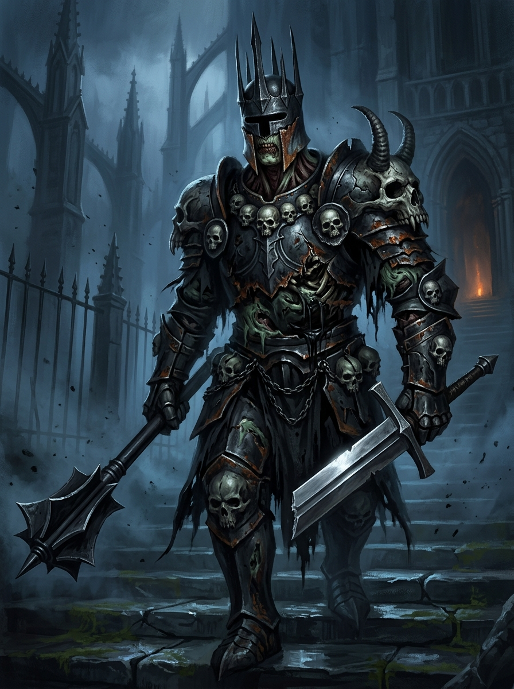
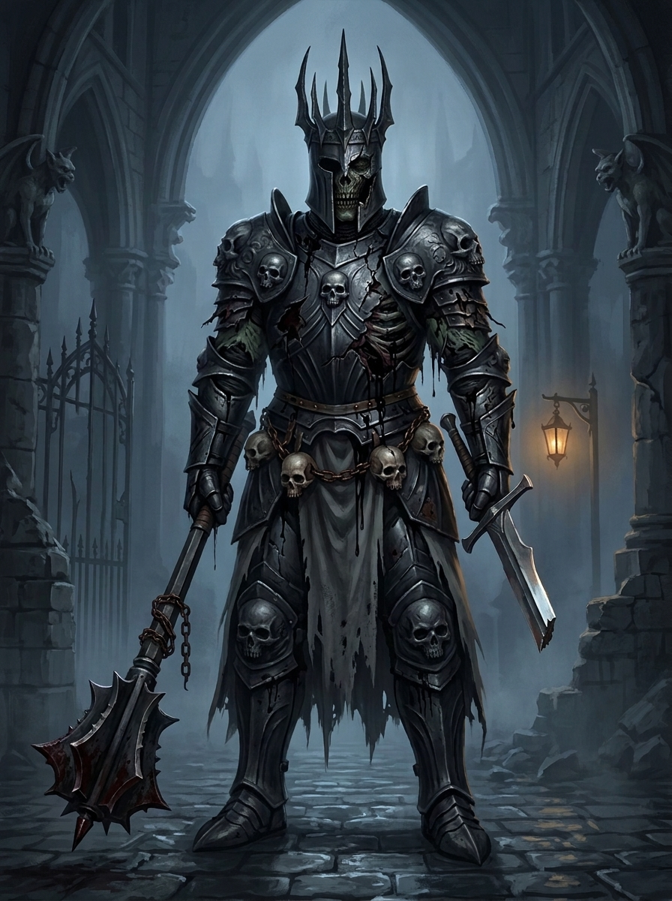
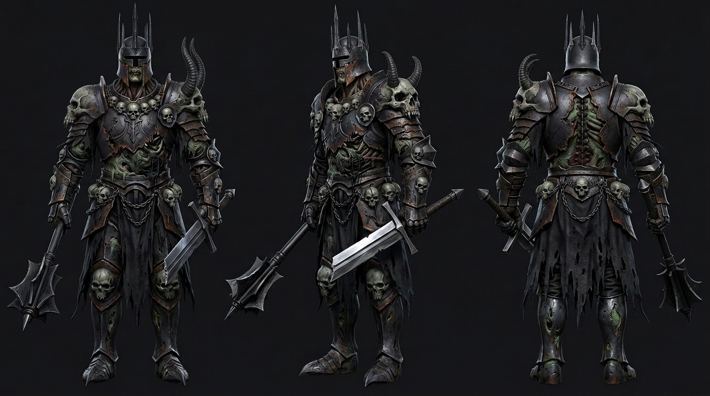
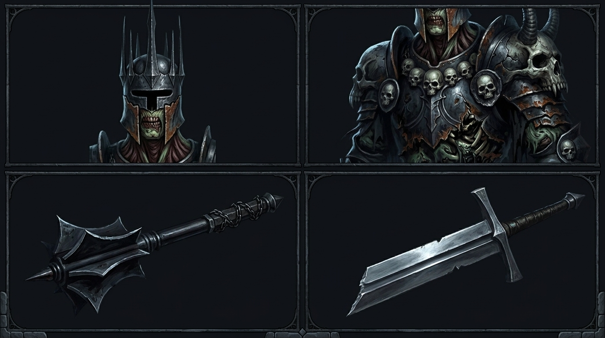
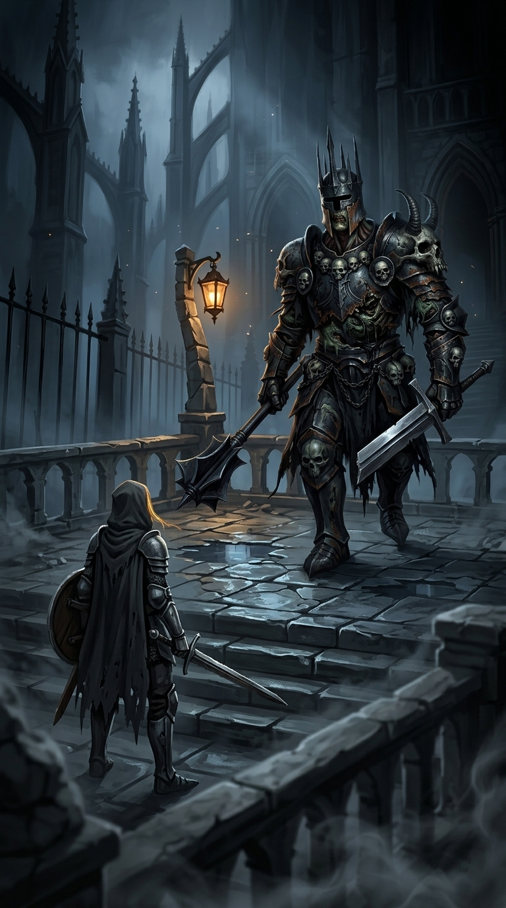

# Roaming Boss — O Perseguidor Coroado (`crowned_pursuer`)

| Campo | Valor |
| --- | --- |
| Status | Conceito visual e spec 3D em verificação (`TASK-054`, `F-023`) |
| Arquétipo / Papel | Roaming Boss (Sistema Nemesis, GDD §13) — anunciado por **2 toques do sino rachado** (GDD §19) |
| Id proposto (futuro) | `crowned_pursuer` (entra em `game/data/enemies.json` + ficha `ENEMY-NN` apenas na tarefa de gameplay Nemesis) |
| Decisões aplicáveis | `ADR-0036`, `ADR-0042` |
| GDD | 6, 7, 11, 13, 17, 18, 19 |

---

## 1. Identidade e Fantasia de Horror (GDD §13)

- **Medo central (1 frase):** *O som duplo do sino rachado às suas costas — saber que um senhor da guerra podre e incansável acaba de entrar no grafo atrás de você e não entra em nenhuma fogueira para esperar.*
- **Lore no mundo:** Quando a Cidade Abandonada e os pátios da Catedral ruíram sob a Febre, os campeões encarregados de selar os portões de quarentena recusaram abandonar o juramento mesmo enquanto a carne apodrecia dentro da própria armadura. As placas de ferro negro fundiram-se aos crânios de seus executados e foram rachar-se de dentro para fora sob o inchaço da praga. Hoje o **Perseguidor Coroado** atravessa as camadas em passadas lentas e inevitáveis, arrastando uma maça de ferro de seis abas e um espadão partido ao meio cujo gume brilha como navalha ao luar.
- **Sinal sonoro:** 2 toques graves do sino rachado ao atingir o alarme de perseguição (`GDD §13`, `§19`), exibindo no mapa a distância em nós (*"O Perseguidor está a N nós"*).

---

## 2. Galeria Conceitual Validada (Nano Banana — `TASK-054`)

Todas as pranchas abaixo foram geradas sem citar jogos, personagens ou artistas nos prompts (`GDD §18`, `ADR-0042` §4) e inspecionadas visualmente quanto a anatomia, armas, corrosão, silhueta e atmosfera gótica.

### 2.1 Prancha 1 — Key Art Mestre (Âncora do Design)



- **Variação complementar aprovada (Key Art Alternativa em arco de catedral com gárgulas e lampião):**



### 2.2 Prancha 2 — Folha Ortográfica 3D (Turnaround Frente / Perfil 3/4 / Costas)



### 2.3 Prancha 3 — Estudos de Ultra-Detalhe (Elmo, Armadura/Crânios, Maça e Espada Quebrada)



### 2.4 Prancha 4 — Prévia de Diorama em Combate Retrato `9:16` (`ADR-0042`)



---

## 3. Conferência contra o Pedido (`F-023`) e o Cânone (`ADR-0042`)

| Requisito | Conferência visual nas pranchas | Status |
| --- | --- | --- |
| **Elmo-coroa vertical pontiagudo** | 5 pontas góticas afiladas em ferro enegrecido sobre visor em T mergulhado em escuridão | OK |
| **Armadura toda negra com detalhes de crânios humanos** | Ombreira direita com crânio esculpido, ombreira esquerda monumental com crânio bicórneo, colar de crânios, cinto com corrente de crânios e joelheira de crânio | OK |
| **Corrompido, armadura desmanchando e carne podre** | Placas negras rachadas, enferrujadas nas bordas e abrindo para fora sobre carne necrótica cinza-esverdeada, costelas expostas, mandíbula/tendões putrefatos e coluna dorsal apodrecida nas costas | OK |
| **Mão direita: maça brutal** | Maça de guerra colossal em ferro negro com 6 abas pontiagudas, cabo octogonal grosso e correntes enroladas | OK |
| **Mão esquerda: espada quebrada ao meio e super afiada** | Espadão largo partido diagonalmente na metade da lâmina, mostrando corte vivo e gumes prateados extremamente afiados ao luar | OK |
| **Craft + Profundidade + Atmosfera Dark Gótica (`ADR-0042`)** | Prancha 4 demonstra diorama em 3 planos (parapeito/Bibiana em primeiro plano, pátio molhado de pedra no palco, arcos ogivais/pináculos/grades/névoa atrás sob luar frio e único lampião âmbar) | OK |
| **Originalidade (`GDD §18`)** | Zero menção a jogos, personagens ou artistas reais nos prompts usados na geração | OK |

### Prompts originais limpos utilizados (`GDD §18`)

- **Key Art Mestre (3:4):** Guerreiro colossal corrupto de 2,75 m descendo escadaria gótica molhada em névoa e cinzas; elmo-coroa negro de cinco pontas sobre visor em T vazio com queixo/pescoço em carne podre exposta; armadura gótica de ferro preto coberta de crânios humanos esculpidos (ombreira esquerda maciça com crânio de chifres) rachando e desmanchando sobre carne necrótica esverdeada, costelas quebradas e tendões úmidos; maça brutal de ferro negro de seis abas na mão direita; espada pesada partida violentamente ao meio com gume de aço prateado extremamente afiado na mão esquerda; arquitetura gótica de arcos ogivais, grades de ferro e foco de brasa distante.
- **Turnaround 3:4 / 16:9:** Folha ortográfica limpa (Frente, 3/4, Costas) em escala idêntica sobre fundo carvão `#121418`, revelando nas costas placas vertebrais partidas expondo espinha e carne necrótica, manto fúnebre em farrapos e geometria fiel das duas armas para entrada em TRELLIS.2 / Blender.
- **Detalhes 16:9:** Grade 2×2 sem texto com macro do elmo-coroa/mandíbula podre, ombreira bicórnea + colar de crânios + peitoral rasgado, cabeça de maça de guerra de seis abas com correntes e lâmina de espadão quebrada ao meio com fio cortante.
- **Diorama 9:16:** Combate em pátio/ponte gótica sob luar frio azul-ardósia (`#7E8FA8`) e único lampião âmbar (`#D97828`), guerreira encapuzada em primeiro plano de costas com única mecha saturada (regra do acento, GDD §18) enfrentando o colosso no centro do palco diante de arcos ogivais e pináculos mergulhados na névoa.

---

## 4. Progressão Visual Nemesis — Patentes 1 a 5 (GDD §13)

Como previsto no GDD §13 (*"um conjunto de modelos-base com recolor e mutações, e cinco patentes"*), a malha base do **Perseguidor Coroado** permite escalonamento visual barato quando o rival mata a Bibiana e retorna em uma Descida posterior:

| Patente | Título sugerido (sufixo) | Adição barata no mesmo modelo / shader | Alteração de risco |
| --- | --- | --- | --- |
| **1** | *O Juramentado* | Malha base (`02-turnaround`) sem brilho de brasa | Atributos base de Roaming Boss (`m_tipo = 3`) |
| **2** | *O Rancoroso* | +1 crânio pendente extra no cinto frontal e marcas de sangue seco nas abas da maça | +1 mutação temática (`ADR-0032`) |
| **3** | *O Desmanchado* | Segunda fenda aberta no ombro direito / coxa com vértices pintados de carne úmida | +10% dano em golpes de Maça |
| **4** | *O Quebrado pelo Sino* | Pó dourado/cinzento de sino rachado sobre as ombreiras e faísca tênue no visor | Reação adicional contra `Defender` consecutivo |
| **5** | *O Rei da Vala* | Olhos/fissuras do peito com emissão tênue âmbar-fúnebre (`emit = 1.6`, sem neon) e farrapos alongados | Drop garantido de `Relíquia de Rival` vermelha + `Alma` |

---

## 5. Proposta de Mecânica de Combate (GDD §6, §7 e §13)

*(Proposta para futura tarefa de gameplay — sem alteração de código ou `RULES_VERSION` nesta etapa.)*

- **Identidade tática das duas armas:**
  - **Maça Brutal (Mão Direita):** golpes lentos, pesados e esmagadores que punem quem confia apenas em armadura (`DEF`) ou tenta manter a luta parada.
  - **Espada Quebrada Super Afiada (Mão Esquerda):** cortes rápidos de alto sangramento/infecção necrótica que aplicam **Fraqueza** ou **Veneno** (podridão das placas).
- **Atributos sugeridos (referência Cenário 1–3, escalados por nível):**
  - Vida alta (`160–190` base), `FOR` alta (`17–19`), `DEF` média-alta (`11`, com frestas pela armadura desmanchando — fraco a golpes perfurantes/críticos e **Fogo/Sagrado** `×1,5`), `VEL` moderada (`5`, pesado mas implacável).
- **Ciclo de golpes proposto (respeitando regra de justiça: intervalo >= 2 golpes entre moedas, sem Golpe Mortal pois Golpe Mortal é exclusivo de chefe de cenário):**
  1. `shattered_edge` (**Gume Partido** — dano físico 1,0× pela espada quebrada).
  2. `mace_decree` (**Decreto da Maça** — **Golpe de Moeda Cruel**, avisado 1 turno antes): em **Cara**, dano reduzido em 50%; em **Coroa**, esmaga com **+100% de dano** e aplica **Atordoamento** ou **Fraqueza (3 turnos)**.
  3. `rot_cleave` (**Corte Podre** — dano + chance 65% de **Veneno** pela carne putrefata que respinga da armadura e lâmina, cortada à metade com `Defender`).
  4. `crushing_sweep` (**Varredura de Ferro** — golpe pesado avisado `1,35×`).
- **Reação signature:** se a Bibiana tentar usar fuga (bloqueada por regra GDD §13) ou ficar com **buffs ofensivos/defensivos acumulados**, responde com **Esmagamento de Guarda** (prioriza `mace_decree` se fora de cooldown, senão `crushing_sweep`).
- **Recompensas ao derrotar (GDD §13):** `Poder ×3`, **1 Alma**, **Relíquia de Rival** (quando promovido em patente >= 2), `Moeda da Sorte` e alívio do medidor de alarme no mapa.

---

## 6. Especificação IA-Friendly para Reconstrução 3D (TRELLIS.2 / Blender `kit.py`)

```yaml
enemy_id: crowned_pursuer
role: roaming_boss
reference_plates:
  master_key_art: docs/design/refs/roaming-boss/01-perseguidor-coroado-key-art.jpg
  turnaround_3d: docs/design/refs/roaming-boss/02-perseguidor-coroado-turnaround.jpg
  details_weapons: docs/design/refs/roaming-boss/03-perseguidor-coroado-detalhes-armas.jpg
blender_conventions:
  facing: "-Y"
  up: "+Z"
  ground_z: 0.0
  origin: [0.0, 0.0, 0.0]
  target_height_m: 2.75
  triangle_budget: "4500-6000 tris (abaixo do teto de 8000 tris de chefe, GDD §18)"
  shading: "flat / sharp-edged low-poly com vertex_grime"
pipeline_route: "TRELLIS.2 (a partir do 02-turnaround ou front view) -> Decimate planar/collapse em Blender -> separação de armas para animação -> vertex_grime + chanfro"
proportions:
  shoulder_width_m: 1.18
  crown_tip_z: 2.75
  waist_z: 1.24
  mace_length_m: 1.58
  broken_sword_total_m: 1.05
  broken_blade_remaining_m: 0.62
parts:
  - name: spired_iron_crown_helm
    coords_m: [0.0, -0.02, 2.02..2.75]
    technique: "Octagonal blackened helm bucket with narrow T-visor recessed void (mat_pitch_void), 5 tapered sharp triangular gothic spires flaring radially along top rim, ragged corroded cheek flaps leaving rotted jawbone and teeth exposed underneath."
  - name: rotting_head_and_neck
    coords_m: [0.0, -0.04, 1.88..2.22]
    technique: "Low-poly sculpted lower jaw with jagged off-white teeth + vertical sinew strips (Skin modifier / extruded ribs) bridging helm cavity to gorget."
  - name: asymmetric_skull_pauldrons
    coords_m: ["right [+0.48, 0.0, 1.72..2.12]", "left [-0.52, 0.0, 1.70..2.28]"]
    technique: "Layered curved shoulder plates; right pauldron embeds 1 sculpted human skull face; left pauldron carries larger oversized skull with 2 sweeping ridged curved horns (6-segment extruded curve cones) and dangling secondary skulls along collar."
  - name: crumbling_cuirass_and_necrotic_torso
    coords_m: [0.0, 0.0, 1.22..1.98]
    technique: "Blackened fluted breastplate and back spine guard deliberately broken along central and lower ribs with bent jagged rust rims; recessed organic rotting flesh mass (Decimated Noise-displaced bmesh) + exposed white/yellowish curved rib bones + exposed spine vertebrae on back view."
  - name: skull_waist_chain_and_shroud
    coords_m: [0.0, 0.0, 0.42..1.30]
    technique: "6 miniature skull medallions strung around hip belt linked by faceted chain segments + draped tattered burial cloth skirts front and back with jagged torn hem strips."
  - name: legs_and_skull_greaves
    coords_m: [±0.22, 0.0, 0.0..1.24]
    technique: "Articulated thigh cuisses with necrotic flesh cuts, skull-relief right poleyn (knee guard), rusted-edge greaves with punctured calf holes exposing rot, pointed gothic sabatons."
  - name: brutal_flanged_war_mace
    coords_m: [+0.62, -0.22, 0.25..1.55]
    attach_hand: right_hand_socket
    technique: "Thick octagonal iron haft wrapped near pommel and neck with spiral chain coils; head composed of 6 sharp radial beveled fin plates + top pyramidal finial spike + rusted rivets."
  - name: half_broken_razor_broadsword
    coords_m: [-0.58, -0.35, 0.55..1.35]
    attach_hand: left_hand_socket
    technique: "Heavy straight crossguard and leather-wrapped two-handed grip; wide thick fuller blade cut sharply off at ~50% blade length with asymmetric jagged diagonal fracture profile; honed silver-metallic beveled cutting edges with slight light specular sheen to emphasize lethal sharpness."
materials_pbr:
  - name: mat_blackened_iron_armor
    hex: "#1E2228"
    roughness: 0.48
    metallic: 0.85
  - name: mat_corrosion_rust_edge
    hex: "#5C3522"
    roughness: 0.78
    metallic: 0.42
  - name: mat_aged_skull_bone
    hex: "#9B9686"
    roughness: 0.82
  - name: mat_necrotic_rot_flesh
    hex: "#4C5E46"
    roughness: 0.36
  - name: mat_wet_dark_gore
    hex: "#2E1412"
    roughness: 0.28
  - name: mat_shredded_shroud
    hex: "#181B20"
    roughness: 0.94
  - name: mat_razor_steel_edge
    hex: "#B8C3CC"
    roughness: 0.22
    metallic: 0.94
  - name: mat_pitch_void
    hex: "#020203"
    roughness: 1.0
animation_pivots:
  root_pelvis: [0.0, 0.0, 1.24]
  upper_torso: [0.0, 0.0, 1.56]
  neck_head: [0.0, 0.0, 2.02]
  right_shoulder_mace: [0.46, 0.0, 1.88]
  left_shoulder_sword: [-0.46, 0.0, 1.88]
  right_wrist_mace: [0.58, -0.18, 1.12]
  left_wrist_sword: [-0.55, -0.22, 1.15]
legibility_480x270: "Tall 5-spired crown + asymmetric horned skull shoulder + massive black 6-flanged mace vs gleaming half-snapped bright silver blade silhouette reads unmistakably even at 480x270 internal resolution."
```
